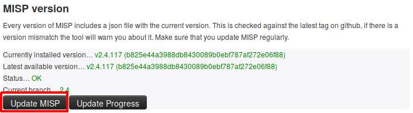
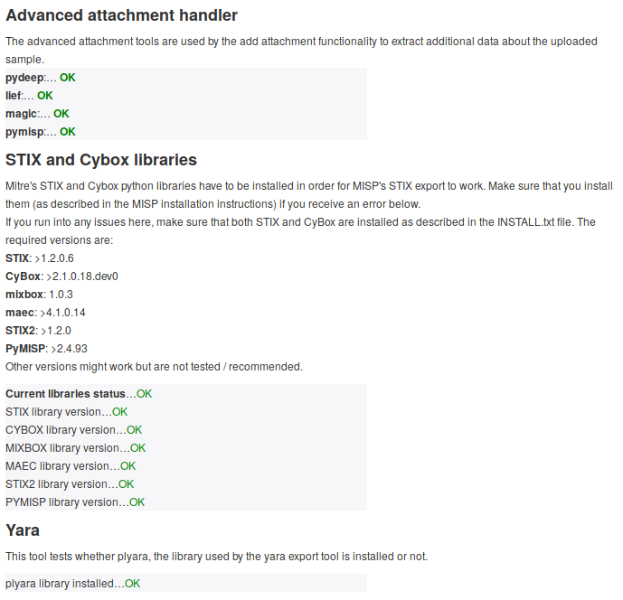

MISP requires several Python libraries for its full feature set to work correctly.

These features include the import and export tools, binary extraction from attachments, and PyMISP.

------

## Installation

MISP uses virtual environments to make Python installation and maintenance easier.

If you use the [installation scripts](https://github.com/MISP/MISP/tree/2.5/INSTALL) to set up MISP on your machine, you already have the latest required Python libraries installed in a virtual environment.

If you are using an older MISP version, you may want to create the virtual environment manually.

#### Set Up the Virtual Environment
~~~~bash
# Create a python3 virtualenv
sudo -H -u www-data virtualenv -p python3 /var/www/MISP/venv

# Make pip happy
sudo mkdir /var/www/.cache
sudo chown www-data:www-data /var/www/.cache
~~~~
If you already have a `venv` directory, you can skip this step.

------

## Updating MISP and its dependencies

Keeping MISP as up to date as possible is the safest way to avoid most potential issues.

You can do this either from the Update button in the diagnostic tool in the MISP UI or from the command line.

### Updating MISP core

To update MISP dependencies, first pull the latest MISP version so you also get the latest submodule references.

OR
~~~~bash
sudo -H -u www-data git pull origin 2.5
~~~~

Once you have the latest MISP update, you can start updating the Python libraries.

### Updating the python dependencies

MISP includes several submodules that support additional functionality, so it is important to keep those dependencies up to date.
~~~~bash
sudo -H -u www-data git submodule update --init --recursive
~~~~

#### Updating python dependencies

You can check the status of all Python libraries required by MISP by using the diagnostic tool again.

If something is wrong, updating the corresponding library should resolve the diagnostic warning.

The simplest and recommended way is to install the pinned set from MISP's top-level `requirements.txt`, which covers PyMISP, misp-stix, the attachment handlers and the other libraries in one go:

~~~~bash
sudo -H -u www-data /var/www/MISP/venv/bin/pip install -U -r /var/www/MISP/requirements.txt
~~~~

If you prefer to update libraries individually:

~~~~bash
# Update PyMISP
cd /var/www/MISP/PyMISP
sudo -H -u www-data /var/www/MISP/venv/bin/pip install -U .

# Advanced attachment handling
sudo -H -u www-data /var/www/MISP/venv/bin/pip install -U lief python-magic
# pydeep2 - WARNING: requires libfuzzy-dev
sudo -H -u www-data /var/www/MISP/venv/bin/pip install -U pydeep2

# STIX 1 and 2 conversion is provided by a single library, misp-stix
sudo -H -u www-data /var/www/MISP/venv/bin/pip install -U misp-stix

# Yara
sudo -H -u www-data /var/www/MISP/venv/bin/pip install -U plyara
~~~~

::: {.callout-note}
The old per-package STIX 1 stack (`python-stix`, `python-cybox`, `python-maec`, `mixbox`) is legacy. MISP 2.5 uses **misp-stix** (`misp_stix_converter`) for both STIX 1 and STIX 2 conversion, and it is included in `requirements.txt`.
:::

If you want to use or update the ZeroMQ functionality, the `pyzmq` library is also part of `requirements.txt`; to update it on its own:

~~~~bash
sudo -H -u www-data /var/www/MISP/venv/bin/pip install -U pyzmq
~~~~

#### Updating MISP modules

Another set of dependencies you may want to update are MISP modules.

MISP modules have their own dependencies that need to be up-to-date as well as the modules scripts themselves.

The following instructions assume that MISP modules are installed in `/usr/local/src/misp-modules`.
Change the path if your installation uses a different location.

~~~~bash
# Change here the path if needed
cd /usr/local/src/misp-modules
# Update misp-modules requirements
sudo -H -u www-data /var/www/MISP/venv/bin/pip install -U -r REQUIREMENTS
# Update misp-modules scripts
sudo -H -u www-data /var/www/MISP/venv/bin/pip install -U .
~~~~

You will then need to restart the modules, please refer to the [documentation](https://github.com/MISP/misp-modules#how-to-install-and-start-misp-modules-in-a-python-virtualenv-recommended).
