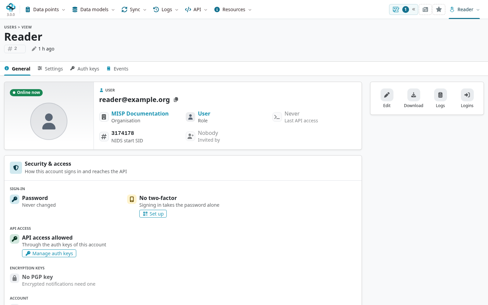
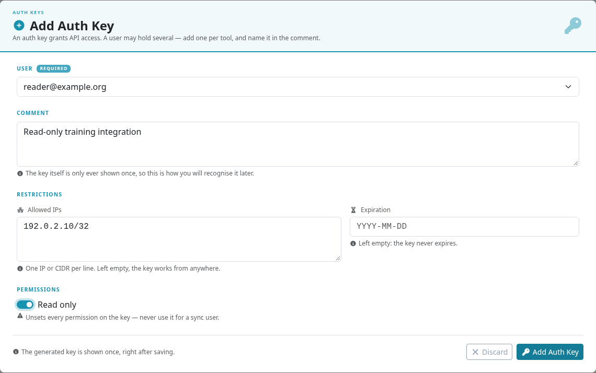

Your account controls how you sign in, receive notifications, and use the API.
Start with your own profile; creating other users and assigning roles are administrative tasks covered in [Administration](../administration/index.qmd#users).

::: {.callout-note}
This chapter describes MISP **3.0.0** from the [`3.0_wip`](https://github.com/MISP/MISP/tree/3.0_wip) development branch, using the light Overmind interface.
Open your account menu at the upper right and choose **My Profile**. Older MISP 2.5 instructions place this under **Global Actions**.
Available controls depend on your permissions and the instance's authentication configuration. Select a screenshot to enlarge it.
:::

<!-- Capture source, fixture and image hashes: ../assets/using-misp-screenshots.json -->

## First run of the system

1. Sign in using the credentials or identity provider supplied by your administrator.
2. Read and accept the instance's terms of use when prompted.
3. If asked to change a temporary password, choose a new one that meets the displayed [password policy](../quick-start/index.qmd#password-policy).
4. Set up the required authentication factors and check your organization and role before entering intelligence.

Externally managed accounts can have a different password or MFA workflow. Follow your organization's sign-in procedure when the corresponding controls are absent.

## Your profile

The **General** tab shows your organization, role, **Security & access**, and notification status.
Use **Edit** to change the fields your administrator allows you to manage, such as your display name, public encryption key, and email preferences.
Passwords, API keys, and authenticator recovery material should remain private.

Check these settings deliberately:

| Setting | What to check |
|---|---|
| Public PGP/GnuPG key, or S/MIME where configured | Supply your public key for encrypted notifications; confirm that you can decrypt a test message. |
| Event publication alerts | Receive alerts only for events you may access; use filters or digests if individual messages are too frequent. |
| Contact requests | Decide whether to receive organization-wide **Contact reporter** messages. Event creators can still be contacted directly. |
| Security & access | Check the enabled sign-in factors and whether your role permits API access. |

Saving a public key does not establish end-to-end protection for every notification: delivery also depends on the instance's mail and encryption configuration.

## API keys

Open the **Auth keys** tab and select **Add authentication key**.
Use a separate key for each integration, with a recognizable comment, a suitable expiry, and an IP allowlist where practical.
Choose **Read only** for an integration that only retrieves data; write or synchronization tasks need their corresponding permissions.

The generated key is shown once. Store it in the integration's secret store, rather than in a report, screenshot, or source repository.
Rotate or revoke it when the integration changes or the key is exposed.
A key remains subject to the user's role and access rights; creating a key does not grant additional access.
See [Automation & API](../automation/index.qmd) for authentication and request examples.

## Multi-factor authentication

The **Security & access** card shows whether built-in two-factor authentication is configured.
Where available, **Set up** opens the TOTP enrollment form.

### Enroll an authenticator

1. Open **My Profile → General → Security & access → Set up**.
2. Add the displayed QR code or secret to your authenticator application.
3. Enter a current verification code to activate it.
4. Save the offered single-use paper tokens securely, separately from the device that generates your codes.

The QR code, setup secret, and paper tokens are credentials. Keep them out of shared documentation.
MISP can require enrollment at first login; instances using an external identity provider or LinOTP can use a different process.

### Sign in and recover access

After entering your password, supply the requested authenticator code or an eligible single-use paper token.
Use **View paper tokens** from your profile where available to retrieve the fallback tokens.
If you lose access, contact your organization administrator or site administrator for a reset, then enroll again.
Built-in TOTP/HOTP and email OTP are alternative flows; do not assume that email provides a second recovery path once TOTP is active.

## Personal settings

The profile's **Settings** tab lists per-user preferences. Use **Add setting** to choose a supported preference and enter its value.
Some settings use JSON: follow the field's help and validate the structure before saving.
Self-management can be disabled by an administrator.

Bookmarks, the personal homepage, theme controls, and [workspaces](../general-layout/index.qmd#workspaces) are also accessible from the main interface; they do not all live in this settings table.
In MISP 3.0, an **analyst profile** controls how assessment signals are interpreted. It is distinct from your login profile and role; see [assessing values](../best-practices/index.qmd#assess-values-across-events-in-misp-3.0).

For notification filtering, use the publish-alert filter supported by your instance.
See [Setting a Publish Alert Filter](../administration/index.qmd#various-administration-tips-tricks) for the filter syntax.

## User administration and roles

A role combines base access with permissions for particular features.
For example, event creation, publication, sightings, Analyst Data, and sharing-group editing can be granted separately.
Organization administrators manage users within their organization; site administrators manage the wider instance.
See [Users](../administration/index.qmd#users) and [Roles](../administration/index.qmd#roles) for those tasks.
