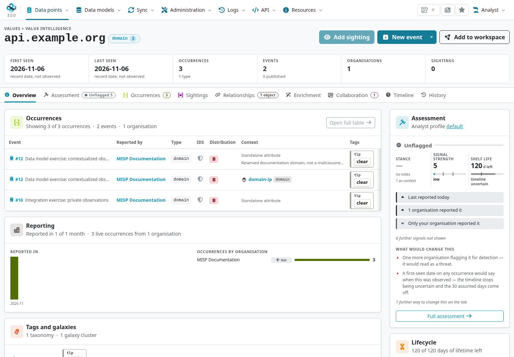

These workflows connect a user's goal to a concrete MISP result. They are starting points for
planning and evaluation, not a promise that enabling one feature completes an investigation or
automatically authorizes sharing.

::: {.callout-note}
Aligned with MISP **3.0.0**, `3.0_wip` commit `99ebee729`. Workspaces, shared-value research,
collections and the current MISP 3.0 views complement events and objects. Each resource keeps
its own ownership, permissions and distribution. External tools/providers require a separate
working integration.
:::

<!-- Implementation references and synthetic examples: ../assets/reference-faq-screenshots.json -->

## Find a workflow {#stories-index}

::: {.table-responsive}

| Goal | Start here |
|---|---|
| Triage an observable or alert | [Investigate a value](#stories-investigate) |
| Coordinate an incident | [Build a shared assessment](#stories-incident) |
| Hand a draft to a publisher | [Analyst review and publication sequence](../using-the-system/index.qmd#publication-review-handoff) |
| Ask another owner to correct an attribute | [Proposal review sequence](../using-the-system/index.qmd#proposal-review-sequence) |
| Transfer event ownership locally | [Delegation sequence](../delegation/index.qmd#delegation-sequence) |
| Describe malware or infrastructure | [Structure the evidence](#stories-structure) |
| Curate intelligence for detection | [Prepare a useful export](#stories-detection) |
| Evaluate external intelligence | [Compare before importing](#stories-feeds) |
| Work with a partner community | [Share within an agreed scope](#stories-sharing) |
| Hand over a campaign or research topic | [Curate a collection](#stories-collections) |
| Explain a finding to stakeholders | [Write a report](#stories-reporting) |
| Automate collection or analysis | [Build a verifiable integration](#stories-automation) |
| Operate a reliable service | [Maintain users and infrastructure](#stories-operations) |

:::

## Investigate a value {#stories-investigate}

**Goal:** An analyst needs to understand an alert without copying every matching record into
a new incident.

Search for the domain, address or hash and inspect the accessible occurrences, source context,
first/last seen, warninglist hits and sightings. In 3.0, a component value's SHA-256 address can
anchor research across occurrences while attribute UUIDs retain their individual identities.
Use a workspace/graph to explore relevant links and record a note, opinion or relationship in
the appropriate scope. A shared value or graph edge is a lead, not confirmation of causality.

**Useful result:** A sourced assessment that identifies what was observed, what is inferred
and what still needs checking. See [value identities](../categories-and-types/index.qmd#types-values)
and [value-level research](../analyst-data/index.qmd#value-level-analyst-data).

## Build a shared incident assessment {#stories-incident}

**Goal:** Responders need to add findings to an investigation while retaining responsibility
for their own contributions.

Create a private event, add structured observations and an event report, and record the team's
analysis separately from the raw observables. Use attribute proposals when suggesting changes
to another owner's data, or an extended event for separately owned additions. Record sightings
with their source and time; a negative sighting is not a universal clearance of an indicator.
Keep case-management/remediation tasks in the connected response process.

**Useful result:** A reviewable incident account with evidence, assessment, ownership and
observation times. See [event lifecycle](../using-the-system/index.qmd#creating-an-event),
[extended events](../extended-events/index.qmd#when-to-use-an-extended-event) and [Analyst Data](../analyst-data/index.qmd#the-three-types).

## Structure malware, fraud or infrastructure evidence {#stories-structure}

**Goal:** A researcher needs to preserve relationships among observations rather than produce
an unqualified list of strings.

Choose object templates that represent the observed entities and declare directional object
references where supported by the evidence. Keep machine classification in taxonomies and
knowledge entities/techniques in galaxies. Record provenance and confidence, including limits
of automated enrichment. Submit samples or private observables to an external service only
through an integration whose disclosure and access policy fits the source data.

**Useful result:** An object model that distinguishes facts, relationships and assessment.
This applies to cyber incidents, fraud and other domain-specific research; selecting an object
type does not establish permission to collect personal data or make the record forensic proof.
See [objects](../misp-objects/index.qmd#objects-use),
[taxonomies](../taxonomy/index.qmd#taxonomy-machine-tags) and
[galaxies](../galaxy/index.qmd#galaxy-concepts).

## Prepare a useful detection export {#stories-detection}

**Goal:** A SOC engineer needs a relevant, current set of observations for a SIEM/IDS or another
protective tool.

Review intended detection use, type, source quality, observation age and target compatibility.
Combine explicit REST search criteria with the appropriate IDS/publication scope, warninglist
handling and supported output format. Decaying scores and sightings can inform a decision;
they do not automatically implement the downstream tool's response policy. Inspect a sample,
count results, test ingestion and keep a checkpoint/retry plan for later updates.

**Useful result:** A bounded export with a documented selection policy and observable delivery.
See [API exports](../automation/index.qmd#api-exports),
[warninglist filtering](../warninglists/index.qmd#warninglists-export) and
[decaying models](../decaying-models/index.qmd#how-scoring-works).

## Compare intelligence before importing {#stories-feeds}

**Goal:** A curator wants useful external context without uncontrolled local event growth.

Review the source's terms, format, quality and update strategy. Compare cache/lookup results
with the local observations before importing full events. Cache entries, imported events and
remote-server data are distinct resources. Inspect repeated imports, UUID/update handling and
correlation volume; label source context rather than treating a feed's inclusion as validation.

**Useful result:** A measured source choice with explicit retention and import behaviour.
See [feed management](../managing-feeds/index.qmd#feeds) and
[feed-growth diagnosis](../faq/index.qmd#faq-feed-growth).

## Share within an agreed scope {#stories-sharing}

**Goal:** A community coordinator needs to exchange useful intelligence with intended partners.

Establish organisation identities, peer credentials and the agreed audience. Apply distribution
and sharing groups, then review publication, attachment scope and peer filters. Local tags or
research attachments do not become global just because the parent event is published.
A relay's hosting organisation is part of the trust design. Delegation transfers publication
responsibility; it is not a guarantee of anonymity against every participant or retained record.

**Useful result:** A tested path to the intended recipient with documented visibility and
ownership. See [sharing](../sharing/index.qmd#sharing-overview),
[delegation](../delegation/index.qmd#send-a-delegation-request) and
[protected-event verification](../cryptographic-keys/index.qmd#how-it-works).

## Curate a collection for handover {#stories-collections}

**Goal:** A team wants a maintained set of related events and knowledge entries for a topic,
campaign or partner briefing.

Create a collection, describe its purpose and add the supported element references. Review
collection and element visibility separately. A collection references its members; it does not
flatten their distribution or guarantee that a recipient receives every referenced object.
Keep analyst conclusions in the appropriate reports/research records and review supported
export/synchronization behaviour for the installed branch.

**Useful result:** A curated entry point with an owner, meaningful membership and understood
visibility limits. See [Collections](../collections/index.qmd#what-a-collection-contains).

## Write and communicate a finding {#stories-reporting}

**Goal:** A risk analyst, incident responder or information-operations researcher needs an
explanation that links conclusions to evidence.

Write an event report with references to the relevant elements and sources. Distinguish a
hypothesis, a confidence assessment and an observed fact. ATT&CK or DISARM technique attachments
organize context; they do not validate attribution or a claim about an information source.
Choose views/statistics for the question and explain selection bias and gaps in the dataset.

**Useful result:** A report the intended audience can interpret and access. See
[Event Reports](../event-reports/index.qmd#writing-a-report),
[galaxy matrices](../galaxy/index.qmd#galaxy-matrices) and
[Analyst Data](../analyst-data/index.qmd#the-three-types).

## Build a verifiable integration {#stories-automation}

**Goal:** A developer or data scientist needs repeatable collection, enrichment or analysis.

Use a suitably scoped account/key and the supported API/client version. Test pagination,
normalization, idempotent updates, permissions and recovery from partial failure. Workflows
can connect triggers, conditions and actions where those modules are enabled; do not assume
an arbitrary tag starts automation. Distinguish a provider request from a cached/local result,
and retain provenance and human review for assisted analysis.

**Useful result:** An integration with bounded inputs, meaningful logs and checked outputs.
See [Automation & Integration](../automation/index.qmd#api-reference),
[workflows](../workflows/index.qmd#workflow-hub) and
[developer testing](../dev-faq/index.qmd#developer-testing).

## Maintain users and infrastructure {#stories-operations}

**Goal:** Administrators need a reliable service with appropriate access and recoverable data.

Separate site administration from organisation/user management. Check the permitted scope of
role/account/key operations rather than granting every administrator instance-wide control.
Monitor jobs, recurring work, migrations, storage, logs and backups; rehearse recovery. A
successful connection test or dashboard chart is one signal, not a complete health assessment.

**Useful result:** A service with clear ownership, tested recovery and auditable changes.
See [administrative access](../administration/index.qmd#admin-access),
[health checks](../administration/index.qmd#server-settings-and-maintenance) and
[backup/recovery](../administration/index.qmd#admin-backup-recovery).
