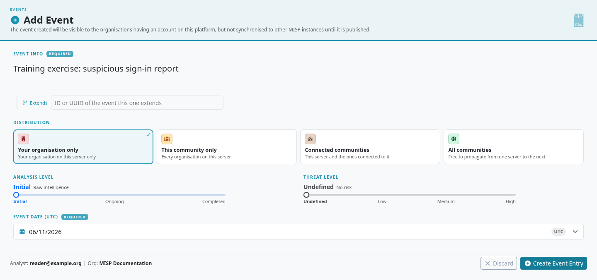
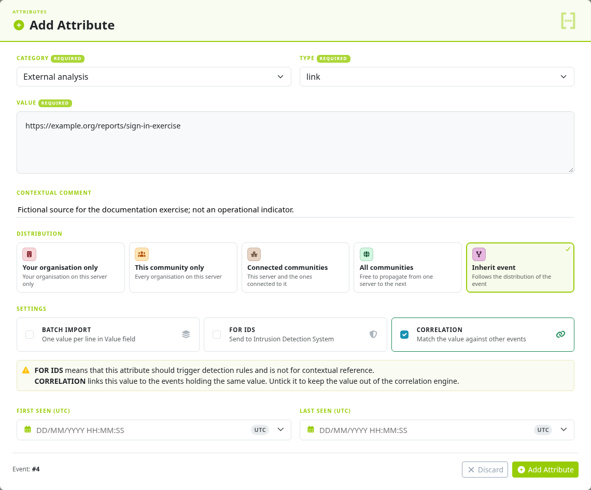
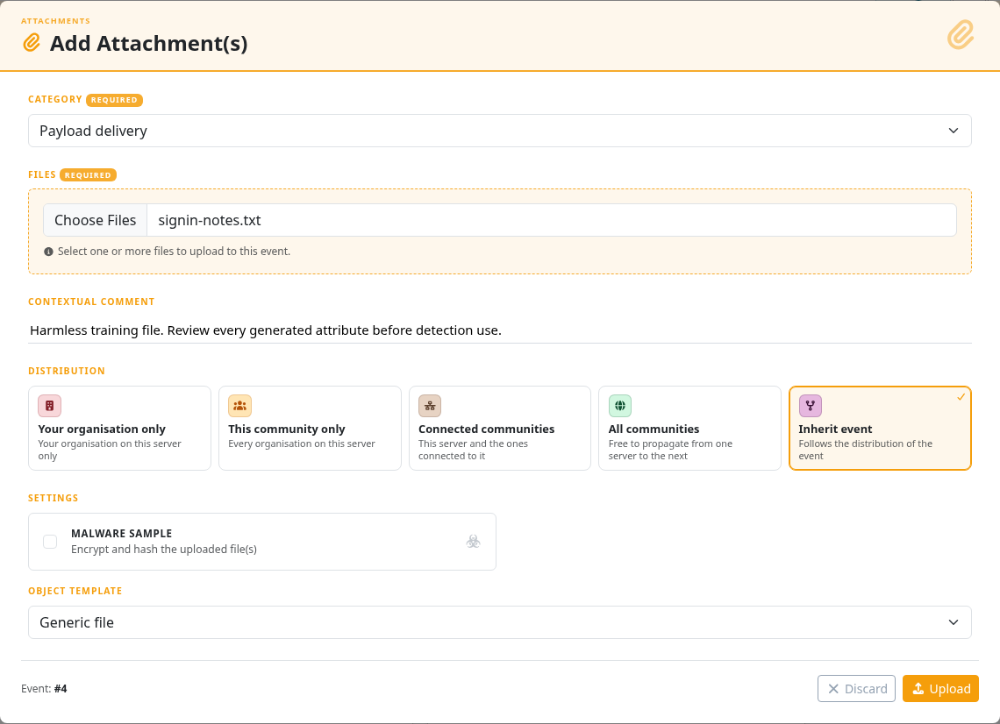
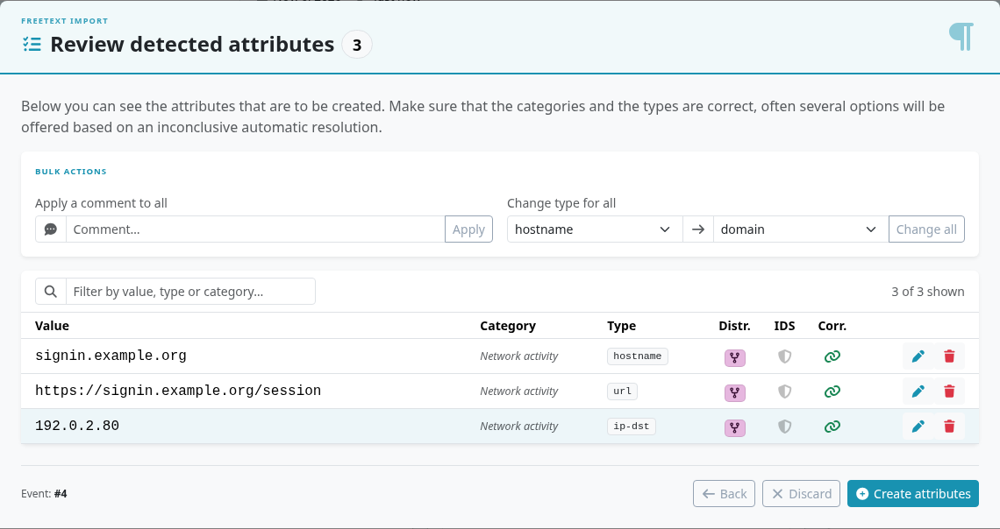
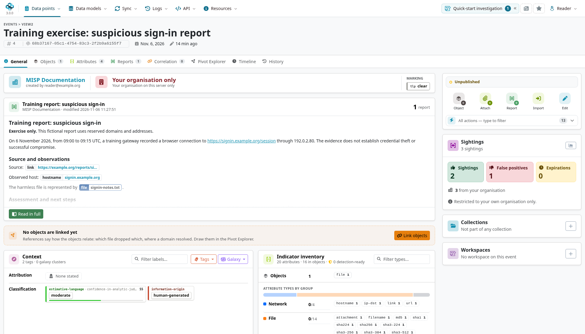
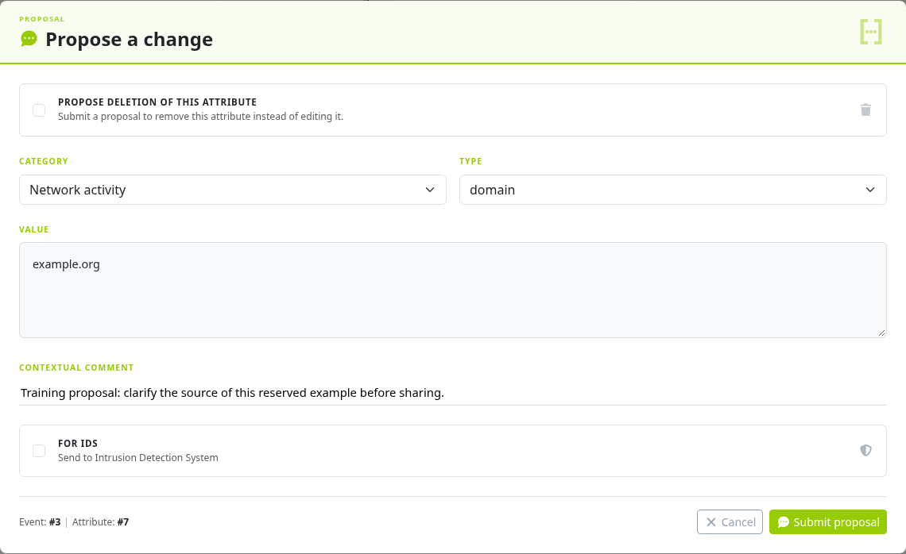
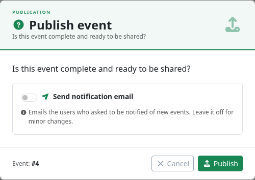
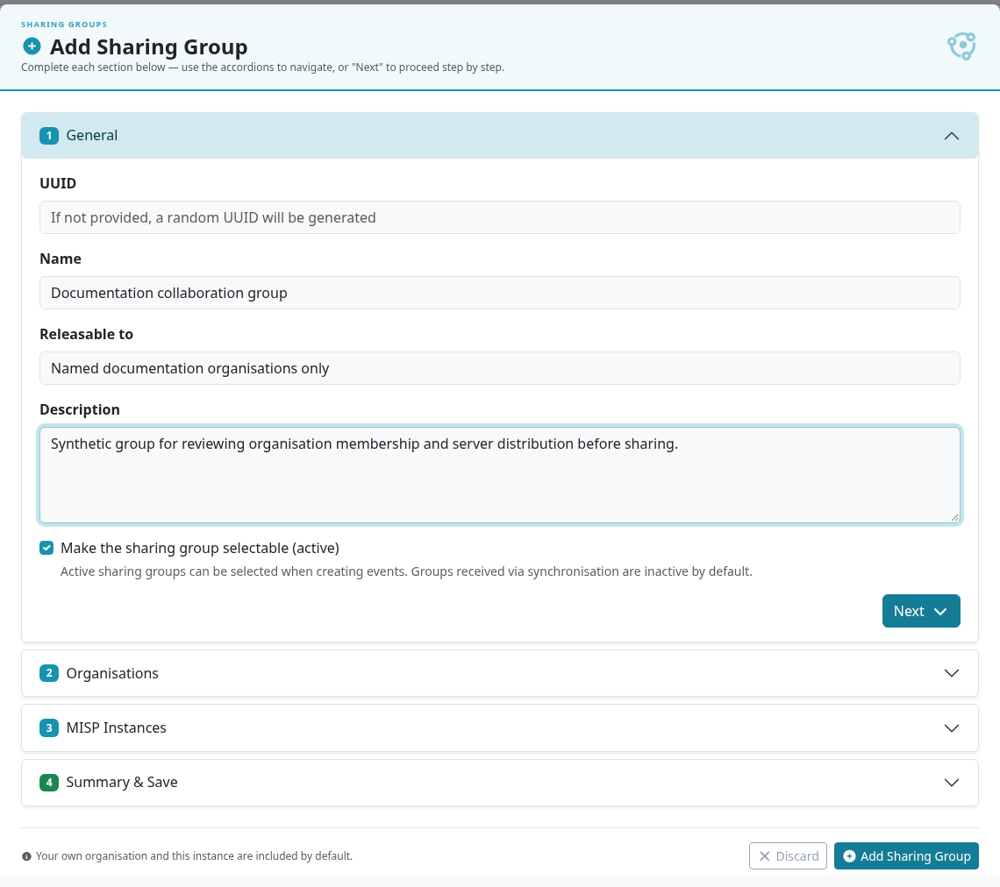

This chapter follows an analyst's daily workflow: create an event, record the evidence, add context, collaborate, and publish a reviewed result.
Use the [report exercise](../create-event-report/index.qmd) for a guided example, or [Quick Start](../quick-start/index.qmd) for a first introduction.

::: {.callout-note}
The instructions and screenshots use MISP **3.0.0** from the [`3.0_wip`](https://github.com/MISP/MISP/tree/3.0_wip) development branch, in light mode.
The event page uses tabs and an action card.
Controls depend on your role, event ownership, and enabled services. Select a screenshot to enlarge it.
:::

<!-- Capture source, fixture and image hashes: ../assets/using-misp-screenshots.json -->

## The event lifecycle

An **event** groups observations and context about an incident, investigation, campaign, or source report.
A useful workflow is:

1. **Create** a clearly titled event with a suitable date and audience.
2. **Populate** it with attributes, objects, attachments, and a narrative report.
3. **Assess** the evidence, sources, confidence, handling requirements, and detection value.
4. **Collaborate** through proposals, sightings, Analyst Data, extensions, or a handover.
5. **Publish** the reviewed event and check the outcome of any synchronization or notification jobs.

Distribution controls access. **Unpublished does not mean private**: unless your instance restricts unpublished events, another organization can already see data distributed to its community.
Use **Your organisation only** for work that must remain within your organization.
After edits, check for unpublished or pending changes and republish when those changes are ready.

## Creating an event {#creating-an-event}

Open **Data points → Events** and choose **Add event**.
The form creates the event container; it does not yet add indicators.

| Field | What to enter |
|---|---|
| **Event Info** | A specific title that identifies the investigation or source. Put the detailed narrative in an event report. |
| **Extends** | The UUID, or local ID, of a parent event when adding an [extension](../extended-events/index.qmd). Otherwise leave it empty. |
| **Distribution** | The intended audience. Review the default before saving. |
| **Analysis level** | **Initial**, **Ongoing**, or **Completed**, reflecting your own analysis stage. A source's publication does not complete your analysis. |
| **Threat level** | A broad event assessment. Use **Undefined** when the evidence does not justify a level; this field is not a substitute for confidence or severity analysis. |
| **Event date** | The incident or report date, according to your community's convention. Record precise observation windows on the attributes. |

The distribution choices are:

| Audience | Meaning |
|---|---|
| **Your organisation only** | Restricted to your organization on this instance; not synchronized as community intelligence. |
| **This community only** | Available to eligible organizations on this instance. It is not permission to propagate it through further communities. |
| **Connected communities** | Can be shared to connected communities, subject to synchronization rules and distribution changes at the next hop. |
| **All communities** | Can propagate between communities, subject to access and synchronization filters. |
| **Sharing group** | Uses an explicit set of organizations and servers. |

Objects and attributes can inherit the event audience or narrow it.
A more permissive attribute setting does not bypass the event's restrictions.
See [distribution best practices](../best-practices/index.qmd#setting-distribution) and [sharing groups](#create-and-manage-sharing-groups).

Where available, **Use a template** starts a guided event-template workflow with predefined objects and fields.
Use it for a recurring report type; confirm that the resulting fields and audience match the evidence.

## Populating an event with data

The event's action card offers shortcuts such as **Object**, **Attach**, **Report**, **Import**, and **Edit**.
Its **All actions** control exposes additional operations and can be searched by name.
The **Attributes** tab also provides **Add attribute**.

### Add Attribute

An attribute records one value with a type, category, and context.
Choose **Add attribute**, then review the form before saving:

- **Category and type** describe what the value means: for example, *Network activity* / `hostname`, or *External analysis* / `link`. Use the [category/type reference](../categories-and-types/index.qmd) when uncertain.
- **Value** holds the observed data. Do not alter a value merely to persuade a parser to recognize it; choose a valid type or add it manually.
- **Contextual comment** explains the source or limitation. It is not a substitute for structured properties such as a port or observation time.
- **Distribution** should normally be **Inherit event**. Narrow it for an exception.
- **For IDS** (`to_ids`) marks detection eligibility. Leave it off for source links, narrative context, training data, and values you have not assessed as suitable for detection. Export and consumer filters still matter.
- **Correlation** controls matching against other events. A match means a shared value, not proof of maliciousness or common ownership.
- **First seen / Last seen** record the observation window, in the timezone indicated by the form.
- **Batch import** creates one attribute per line using the selected category and type. Use it for a homogeneous list, rather than mixed indicator types.

### Add Object

Use **Object** to choose a template and group related properties of one entity.
For example, a `file` object can hold its name, size, hashes, and attachment.
Populate only supported facts, and use object references to describe relationships between entities.
See [MISP Objects](../misp-objects/index.qmd) for templates and references.

MISP 3.0 separates the **Objects** and standalone **Attributes** tabs.
Expand an object to inspect its attributes; its children are not additional unrelated observations just because several hashes describe the same file.

### Add Attachment

Choose **Attach** to upload a source document, screenshot, sample, or other supporting file.
Set the category, comment, distribution, and representation before uploading.

The **Malware sample** option requests encrypted packaging and hashing for a suspected malicious file.
Password-protected storage does not make the contents safe to execute; use your organization's sample-handling process.
For a harmless document, turn that option off and choose either an attachment attribute or an appropriate object template.
The 3.0 form offers templates for both malware and non-malware uploads.

**Advanced extraction** depends on installed tooling and the selected template; the form reports its availability.
After uploading, inspect the generated object and attributes, including distribution and IDS flags.
Automatic extraction does not establish that every derived value belongs in detection content.

### Populate from…

Choose **Import** to open **Populate from…**.
The pinned 3.0 form groups **MISP JSON**, **Freetext Import**, **Forensic analysis** (Mactime), and enabled import modules into separate sections.
Other formats depend on the installed modules and the interface version; do not expect every legacy import shortcut to appear.

For freetext import, paste the text or indicator list and choose **Run Freetext Import**.
Review the detected values, categories, types, audience, IDS flags, and any matches before creating attributes.
Use each row's edit control to correct an interpretation, and remove material that does not belong in the event.

Treat import output as suggestions. A valid-looking hash or address does not establish provenance, relevance, or permission to share it.
For the complete exercise, see [Create an Event Based on a Report](../create-event-report/index.qmd#freetext-import-tool).

## Adding context to your data

### Tagging: taxonomies, galaxies and tag collections

The **General** tab's **Context** card groups classification and galaxy information.
Use **Tags** for handling, confidence, provenance, and other taxonomy labels; use **Galaxy** for richer context such as a threat actor, malware family, or ATT&CK technique.
Attribute rows have their own tag and galaxy controls.

Apply an event tag when it describes the whole event and attribute tags for specific observations.
Use **TLP 2.0** labels for new data and set distribution separately; a TLP tag is not an access-control setting.
**Tag collections** apply a predefined bundle of tags and are distinct from intelligence [collections](../collections/index.qmd).

Global tags travel with shared intelligence. Local tags support instance-local work and are not synchronized as global markings; check any export options that explicitly include local tags.
With tagging permission, a member of the instance's host organization can add local tags to an accessible event even when another organization created it.
Creator-organization users need the appropriate tagging and event-edit permissions; see [local event-tagging permissions](../taxonomy/index.qmd#taxonomy-local-tagging-permissions) for the rules and the checked 3.0 editor limitation.
See [Taxonomies](../taxonomy/index.qmd), [Galaxies](../galaxy/index.qmd), and [tagging best practices](../best-practices/index.qmd#tagging).

### Analyst data: notes, opinions and relationships

Use a **Note** for evidence or caveats, an **Opinion** for an assessment, and a **Relationship** for a directed, labelled link.
The event's **Assessment** card and element-level controls expose this analysis without requiring a copy of another organization's event.

In 3.0, annotations can also target an **attribute value** across events.
Use **Value Intelligence → Collaboration** when the claim applies to the value as a whole; use an attribute target when the claim depends on one occurrence, source, or time window.
Every annotation has its own sharing settings. See [Analyst Data](../analyst-data/index.qmd).

### Enrichment

Enrichment queries configured services for additional context or candidate attributes.
Event-wide actions appear under **All actions** when the relevant services are enabled; attribute and value views offer their available lookups.
Review the proposed additions and their provenance before accepting them.

Availability depends on installed [misp-modules](../modules/index.qmd), service settings, and permissions.
Check what an external service receives before sending restricted data.
The same applies to optional AI actions: a generated summary or extracted indicator still needs analyst review.

### Decaying scores

[Decaying models](../decaying-models/index.qmd) compute time-sensitive scores for mapped attribute types.
A low score can inform detection selection, but does not automatically clear `to_ids` or filter every export.
MISP 3.0's **Value Intelligence** and **analyst profiles** offer a broader assessment of a value; their labels and shelf-life assessment are not interchangeable with a decaying-model score.

## The event view

The event title, ID, UUID, date, and change timestamp identify the record.
The main tabs separate overview, structured data, narrative, investigation tools, and history.

### General event information

Use **General** to review the creating organization, distribution, markings, reports, context, inventory, attachments, and assessment.
The side column contains actions and related collections, events, or workspaces where available.
Expand **Details** for analysis stage, threat level, correlation, protection, publication, and change information.

A **Protected** event restricts synchronized updates to approved signatories when event signing is configured.
It is not a statement that its indicators are benign or independently verified; see [Cryptographic Keys](../cryptographic-keys/index.qmd).

### Content tabs {#content-toggles}

| Tab | Use it to… |
|---|---|
| **General** | Review the event's context, audience, narrative summary, and assessment. |
| **Objects** | Browse modeled entities and expand their properties and references. |
| **Attributes** | Inspect standalone values, tags, distribution, IDS flags, sightings, and available row actions. |
| **Reports** | Open and manage the event's Markdown reports. |
| **Correlation** | Investigate other events sharing values with this one. |
| **Pivot Explorer** | Explore relationships between event entities. |
| **Timeline** | Inspect temporal context where observation times are available. |
| **History** | Review changes and their authorship. |

Tabs and actions can vary with features, permissions, and the selected view.
For ATT&CK context, inspect attached galaxy clusters and the matrix controls available on your MISP 3.0 instance.

### The attribute table

Use the search and **Filters** controls to narrow the displayed attributes.
Rows show the value and comment, category, type, tags, galaxy context, audience, IDS and correlation state, related data, sightings, and analysis controls.
Table and card views offer different ways to inspect the same data.

Use row actions to edit or delete where permitted, add tags or analysis, or open sighting details.
Check the confirmation before deleting: a soft deletion can propagate and may be restored, while a permanent deletion cannot.
Inspect object attributes in the **Objects** tab rather than assuming the standalone table is the full event inventory.

### Pivoting and related events

A related event shares a correlating value, such as an address, domain, or hash.
Follow the related-event link, inspect the matching attributes, and compare sources and observation times.
Shared hosting, reused infrastructure, and copied reports can create correlations without establishing a common campaign.

For work spanning several pages, add relevant material to a [workspace](../general-layout/index.qmd#workspaces).
For one value across events, use **Data points → Value Intelligence** and inspect its occurrences and effective analyst profile.
A workspace connection used while exploring is not automatically an asserted Analyst Data Relationship.

For a worked investigation using infrastructure, favicon, DOM and cookie-name selectors, see [Pivoting from One Observation to Related Infrastructure](../pivoting/index.qmd).

### Event discussion

Where discussions are available, use them for coordination around an event.
For analysis that recipients should find attached to a particular event, object, attribute, or value, use **Analyst Data** and set its distribution explicitly.

## Collaborating on events

### Proposing changes to another organisation's event

Proposals suggest additions, corrections, deletions, or IDS changes without editing the source organization's event directly.
In an attribute row, open the actions menu and choose **Propose change**. Review the value, comment, and IDS setting, explain the correction, and submit the proposal for the creating organization to accept or discard.
Delivery to another instance depends on synchronization and proposal settings; confirm that the producer has received the request when timing matters.

Use [Analyst Data](../analyst-data/index.qmd) for an additional assessment or caveat that does not replace the observation, and an [extension](../extended-events/index.qmd) for a separate contribution with its own lifecycle.

### Sightings

A sighting records an observation, a false-positive assessment, or an expiration.
It does not prove malicious activity merely because a value was observed.
Open the attribute's **Sighting details** control to inspect its journal or add a dated record with a source.
See [Sightings](../sightings/index.qmd) for the 3.0 interface and visibility rules.

### Contacting the reporter

For a locally created event, **All actions → Contact Reporter** opens an email form.
Choose whether to contact only the creator or eligible users in the reporting organization.
The form appends your email address and event details; review the message and audience before sending.
Notifications require the instance's mail service and recipient preferences to allow delivery.

### Delegating an event

**All actions → Delegate Publishing** requests a handover to another local organization, where enabled and permitted.
The recipient reviews the request before ownership changes.
Delegation does not guarantee anonymity, scrub the narrative or attachments, or automatically publish the event.
See [Delegation](../delegation/index.qmd) for eligibility, requested distribution, and acceptance.

## Publishing an event {#publish-an-event}

Publication marks a reviewed version as ready for sharing and triggers configured synchronization behavior.
You need publication permission as well as access to modify the event; event creation permission alone is insufficient.

In the 3.0 interface, **Publish** opens a confirmation with an optional notification switch.
The normal **Publish** path starts with notifications off; enabling the switch changes the action to **Publish & notify**.
Review the intended destinations and notification choice before confirming.

Publication, distribution, IDS eligibility, warninglists, and consumer filters are separate decisions.
An event becoming published does not make every attribute detection-ready or automatically deliver it to every partner.
With background jobs enabled, check job and synchronization results rather than treating a queued action as completed delivery.

**Unpublish** clears the local published state. It does not erase copies already pulled by other instances or retract content already exported into another tool.
Use the appropriate correction, deletion, and partner-notification process when previously shared intelligence needs to be withdrawn.
**Publish Sightings** synchronizes sighting updates without treating them as a new event publication.

## Extending events

An [extended event](../extended-events/index.qmd) adds your separately owned contribution to a parent event.
Enter the parent's UUID in **Extends** when creating the contribution.
Combined views respect access to the parent and each extension; publication and ownership remain separate.

## Browsing and searching

### Listing events

Open **Data points → Events**.
Use the search, filters, sortable columns, and table/card controls to find events by title, source, date, audience, or publication state.
Choose a row to inspect the event before applying an action.
See [General Layout](../general-layout/index.qmd#page-level-controls) for the index controls.

### Listing and searching attributes

Open **Data points → Attributes** to search across accessible attribute occurrences.
Filter by value, type, category, tags, organization, and time as supported by the page.
An attribute result retains its event context; use **Value Intelligence** when your question concerns the value across occurrences.
For reproducible searches and exports, save and test the corresponding [REST query](../automation/index.qmd).

## Editing events and attributes

Edit the event or individual element through its available controls.
Owning the local copy does not always give you permission to change another organization's source event; use a proposal, annotation, or extension where appropriate.
Check the record's history, time windows, distribution, and publication state after a change.
Republish approved changes when required, and confirm that downstream consumers receive them.

## Create and manage Sharing Groups {#create-and-manage-sharing-groups}

A sharing group names the organizations and servers permitted to receive selected data.
In 3.0, open **Sync → Sharing Groups → List Sharing Groups**; creating or editing one requires the corresponding permission.
Group extenders can help maintain membership according to the group's permissions.

Review the following before selecting a sharing group as an event's distribution:

- **Metadata and active state:** use a clear name and purpose. A human-readable releasability description does not itself enforce access.
- **Organizations:** include the intended local and external organizations; grant extender rights deliberately.
- **Servers and roaming:** check which instances may receive the data. Roaming relies on organization eligibility rather than a fixed server list.
- **All organizations on a server:** use this only when the intended audience really is that whole community.

A group has no effect on an event until the event or one of its elements selects it.
Use **Inherit event** for elements with the same audience and inspect any exceptions.
Verify the receiving organization's view; two groups cannot be treated as numerically ordered levels of restriction.
See [Sharing & Synchronisation](../sharing/index.qmd) for server configuration.

## Exporting data

Use **All actions → Download as** for a single-event export.
The chooser lists formats and enabled export modules available on your instance.
For bulk exports, use `/events/restSearch` or `/attributes/restSearch` with an explicit format and tested filters.

Check distribution, publication filters, tags, IDS eligibility, and any decay or warninglist filtering required by the consumer.
A format's presence in the menu is not a guarantee that the receiving tool will interpret every MISP feature.
See [Automation & API](../automation/index.qmd) for the supported formats and parameters.

## Connecting to other instances

Server connections, sync users, push/pull filters, and feeds require the appropriate administrative setup.
See [Sharing & Synchronisation](../sharing/index.qmd), [Managing Feeds](../managing-feeds/index.qmd), and [Administration](../administration/index.qmd).
Test the recipient's access and received content before relying on a connection for a handover.

## REST API {#rest-api}

Use a scoped authentication key and the [Automation & API reference](../automation/index.qmd) for programmatic work.
The API covers events, attributes, objects, reports, and Analyst Data, including 3.0's value-addressed annotations.
For Python integrations, see [PyMISP](../pymisp/index.qmd).

## Multi-factor authentication (TOTP/HOTP)

Account security is covered in [User Accounts and Preferences](../user-management/index.qmd#multi-factor-authentication).
Start enrollment from **My Profile → General → Security & access → Set up**.

### Generating TOTP/HOTP tokens

Enroll your authenticator, verify a code, and store the offered single-use paper tokens securely.
See the [enrollment steps](../user-management/index.qmd#enroll-an-authenticator).

### Logging in with TOTP/HOTP

After password verification, enter the requested current authenticator code or a valid unused paper token.
Externally managed authentication can use a different flow.

### Deleting and regenerating tokens

Ask an authorized organization or site administrator to reset lost credentials, then enroll again.
Do not send the old secret or recovery tokens in an event or support screenshot.

### Combining multiple factors

Built-in TOTP/HOTP and email OTP are alternative flows in this workflow.
For instance-wide policy and external authentication, see [Administration](../administration/index.qmd).
