Value Intelligence answers a question that starts with an observable: **what does MISP know about this value, across the records I can access?**
Use it to investigate a URL from an alert, compare a domain's appearances in different events, enrich a hash, or review how an assessment changed over time.
The event remains the source context; Value Intelligence brings those contexts together without merging them.

::: {.callout-note}
This chapter follows MISP **3.0.0**, [`3.0_wip` commit `99ebee729`](https://github.com/MISP/MISP/commit/99ebee729702c560528f9788953719bda68aa1c1).
Screenshots show the real interface with fictional, organization-only, unpublished exercise events and IDS disabled on every exercise attribute.
Only the local URL parser was run; no external intelligence provider was queried.
Counts, available modules and assessments depend on your data, permissions, configuration and analyst profile.
Select a figure to enlarge it.
:::

<!-- Capture provenance and verification: ../assets/value-intelligence-screenshots.json -->

## Open intelligence for a value {#value-intelligence-lookup}

Open **Data points → Value Intelligence**, paste a value into **Look up**, and choose **Open intelligence**.
For the exercise below, use:

```text
https://portal-invoice.example/signin?case=DOC-VALUE-001
```

Use **Search** when you need to discover stored values rather than open a known value.
A pasted list produces a worklist; **Extract from text** finds candidate observables in prose.
Review the extracted candidates before investigating them: extraction identifies syntax, not maliciousness.
For a value that legitimately contains a comma, check whether you need the offered whole-line interpretation rather than a split list.

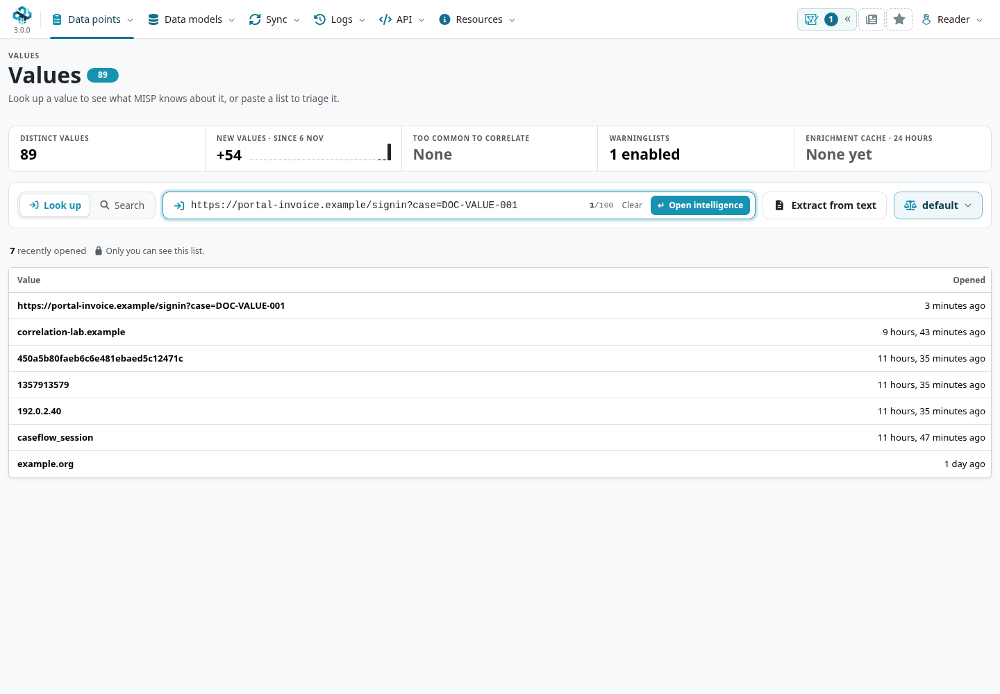

The value page groups accessible occurrences, their events and organizations, sightings, enrichment answers and analyst contributions.
Use the header's counts as entry points into the corresponding tabs.
Keep three distinctions in mind:

- A **value** is the text you are investigating. The same text can occur in attributes with different types or as a component of a composite attribute.
- An **occurrence** is a particular record with its own event, type, source context, observation times, IDS flag and audience.
- A **correlation** is a match produced under MISP's correlation rules. An occurrence list can include records that do not participate in native correlation.

A page with no accessible occurrences does not establish that the value is harmless or absent from other organizations' intelligence.
You can investigate a new value without first creating an event; available enrichment can use an inferred or selected input type.
Check that type before sending a request.

## Exercise: investigate a reported sign-in link {#value-intelligence-exercise}

Imagine an analyst receives a link from a reported email and later finds it in a gateway record.
A third report quotes the same link as a benign control.
The task is to distinguish those contexts, inspect the URL's structure and document what the evidence supports.

To reproduce the example, [create three events and add attributes](../using-the-system/index.qmd).
Keep them **Your organisation only**, unpublished, and set **to_ids** off.
Use the following constructed data; these reserved names and addresses do not represent a real service.
Event IDs are assigned by your instance and will differ from the screenshots.

::: {.table-responsive}

| Event | Attribute whose value is the complete URL above | Additional context | URL observation window (UTC) |
|---|---|---|---|
| **A — reported sign-in link**, dated 1 November 2026 | Type `url`; comment identifying a fictional email report | Domain `portal-invoice.example`; `ip-dst` `192.0.2.180` | 1 November, 09:00–09:10 |
| **B — gateway follow-up**, dated 3 November 2026 | Type `url`; comment identifying a constructed gateway follow-up | Same domain; `ip-dst` `198.51.100.90` | 3 November, 14:00–14:30 |
| **C — quoted benign control**, dated 6 November 2026 | Type `comment`; explain that the URL is quoted text, not a connection | Same domain | Leave unset: the quotation is not an observation window. |

:::

Set **first_seen** and **last_seen** on A and B's URL attributes.
Through those attributes' [sighting controls](../sightings/index.qmd), add a positive sighting for A at **1 November, 09:05 UTC**, a positive sighting for B at **3 November, 14:15 UTC**, and a **false-positive report** for B at **7 November, 12:00 UTC**.
Name the sources, for example *Documentation email simulation* and *Documentation gateway simulation*, and explain the false-positive assessment in a note.
In the development interface shown here, the value header's **Add sighting** action is disabled; use the underlying attribute's controls.
These timestamps describe the exercise; enter the equivalent times for your interface's timezone.
The IP addresses are deliberately supplied co-occurrence context, **not DNS answers**.

Look up the URL again.
The overview shows **three occurrences, three events and one organization**.
Two positive sightings and one false-positive report are separate counts.
Three events from one organization do not establish three independent sources, and repeating a URL in a comment does not create another network observation.

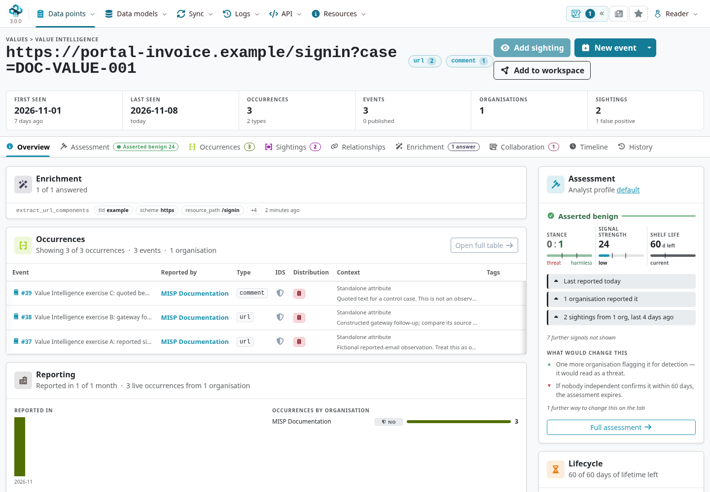

## Compare occurrences and correlate with other events {#value-intelligence-occurrences}

Open **Occurrences** and inspect each event link, type, comment and observation window.
Use the type chips beside the value or the table's filters to narrow to `url`; in this exercise, that leaves A and B.
Clear the filter to restore the quoted comment from C.
A filter changes the display, not the attributes or the correlation policy.

The time controls distinguish attribute creation/modification and event times from **first/last seen**.
Filtering on first/last seen removes occurrences that have neither field set; it does not assign them an observation time.
Use **Columns** to expose additional context and follow an event link when a shortened comment or row summary needs explanation.

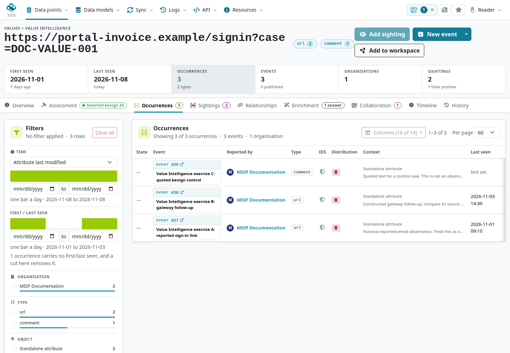

Next, open **event A → Correlation** and inspect the matching values behind each related event.
The URL provides the native match to B.
C's `comment` occurrence does not provide a native URL correlation, but **C can still appear as a related event because its domain matches A's domain**.
An event-level count summarizes all its matching attributes; it is not the URL's occurrence count.
Other data on your instance, correlation exclusions or disabled correlation can change the result.
See [Correlation](../correlation/index.qmd) for matching rules, exclusions and the event graph.

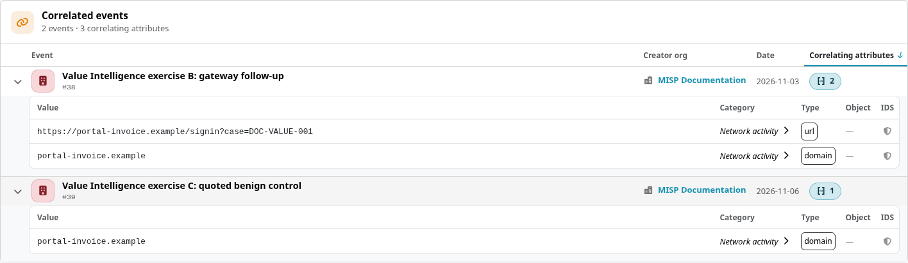

### Explore relationships without overstating them

Return to the value's **Relationships** tab.
**In the same events** lists the domain and the two constructed IP addresses.
Group by value, event or object and use the available type, event and organization filters to understand which context produces a neighbor.
Follow the domain into its own value page to continue a pivot.

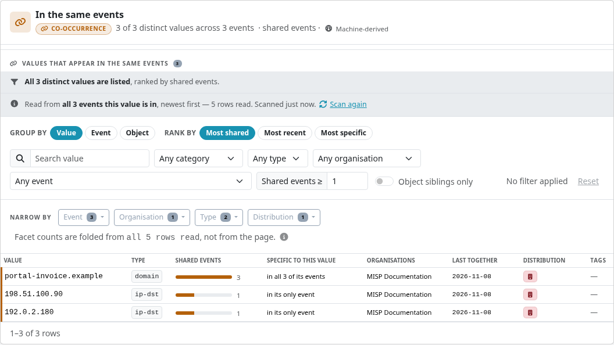

Co-occurrence establishes that records appear together; it does not establish a DNS resolution, common owner or communication.
The other relationship sections keep different evidence separate: dated object relations, engine-specific near-matches, cached external presence, object references and analyst assertions.
Read each section's explanation, including unavailable engines, scan bounds and cache scope.
A near-match is not equality, and an external cache miss does not search every remote event or provider.

The **Neighbourhood** and full graph help navigate these connections.
Opening a node or adding it to a workspace is an investigation step; it does not create an asserted relationship.
The [pivoting use case](../pivoting/index.qmd) develops this discovery-and-validation workflow further.

## Enrich deliberately and review the answer {#value-intelligence-enrichment}

Enrichment asks a module a specific question about a value and input type.
It can extract structure locally or query an external service, depending on the module.
Before running one, read its request context and check who operates it, what data it receives and whether its answer addresses your question.
Some modules receive a full attribute structure rather than only the displayed text.

For this example, an administrator has configured [misp-modules](../modules/index.qmd) and enabled **`extract_url_components`**.
This parser works locally and requires no reputation-provider account.
If it is missing, check module-service availability, instance enablement, accepted types, organization restrictions and the effective analyst profile with your administrator.
A profile cannot enable a module the instance does not offer.

1. Open **Enrichment** and select **extract_url_components** in the module list to inspect its request.
2. Confirm the input is being asked as **`url`**. This value also has a `comment` occurrence; that does not make `comment` the right parser input.
3. Press **Run extract_url_components**. Selecting a module or ticking its checkbox alone does not run it. **Run … selected** runs the checked modules.
4. Expand the returned **url** object and read its attributes. Here it contains the original URL, `https`, `/signin`, `case=DOC-VALUE-001` and the parsed domain, among other components.

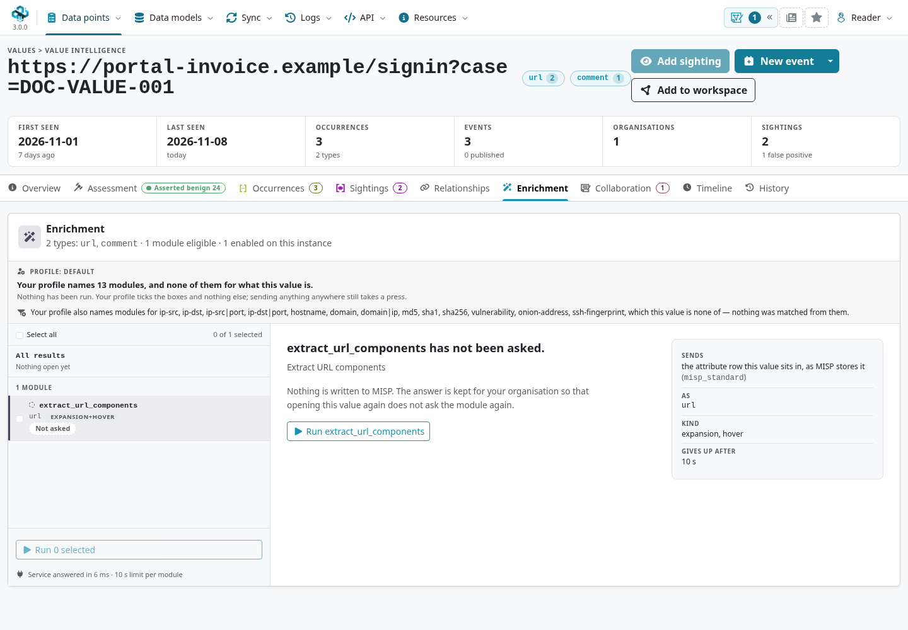

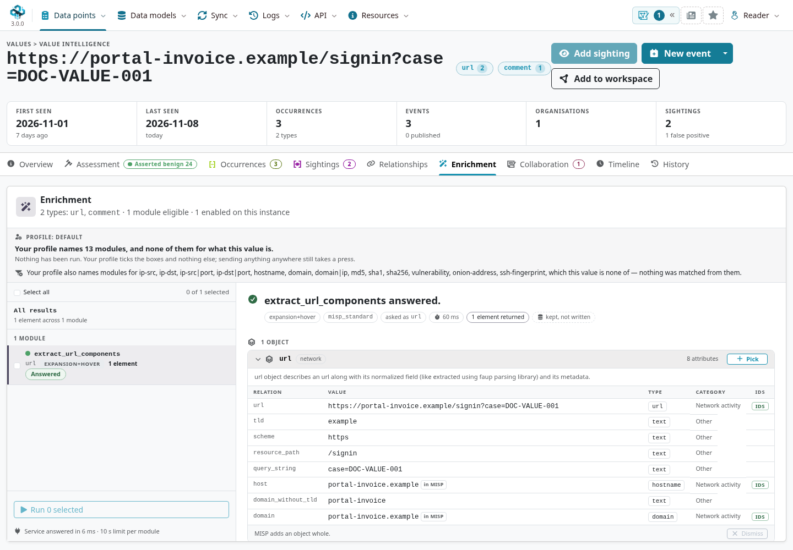

Parsing does not contact the destination, resolve its current IP address or establish its reputation.
The domain's **in MISP** badge means an accessible stored value matches; inspect its event and type context before calling that corroboration.
Known-value indicators are resolved for the current reader, rather than granting access to another user's matches.
A failed request, missing provider key or timeout supplies no clean bill of health.

### Reuse answers and decide what to save

The answer is retained **for your organization**, separately from event attributes.
Reopen the value, select the module and choose **Show the rows** to read the held answer without asking again.
Check its age and input type before relying on it.
A manual **Run again** or **Ask again** requests a fresh answer even when one is already held; the store retains the latest answer for that organization/value/module/type, not a complete sequence of every response.

Automatic execution requires both the effective profile's `auto` declaration and the instance's **`Plugin.ValueIntelligence_enrichment_auto_run`{.text-wrap .text-break}** setting, which defaults to off.
The profile's **`max_age_hours`** reuse window governs automatic reuse; it does not prevent a deliberate manual refresh.
Profile-selected checkboxes and a stored-answer display are different from automatic execution.
See [module integration](../modules/index.qmd#modules-misp-value) for the surrounding service configuration and other enrichment entry points.

A result is **not automatically imported into an event**.
To turn a finding into a new record, use **Pick** on the desired result and open **New event** to review the proposed content and event settings.
An object is picked as a whole, so inspect all its component attributes and suggested IDS flags.
Check the audience, provenance and detection flags before creating the event; then review its tags and full context before publication.
Parser defaults are not a detection decision.
For an existing event, use the [attribute enrichment and review workflow](../modules/index.qmd#modules-misp-attribute) appropriate to that event.

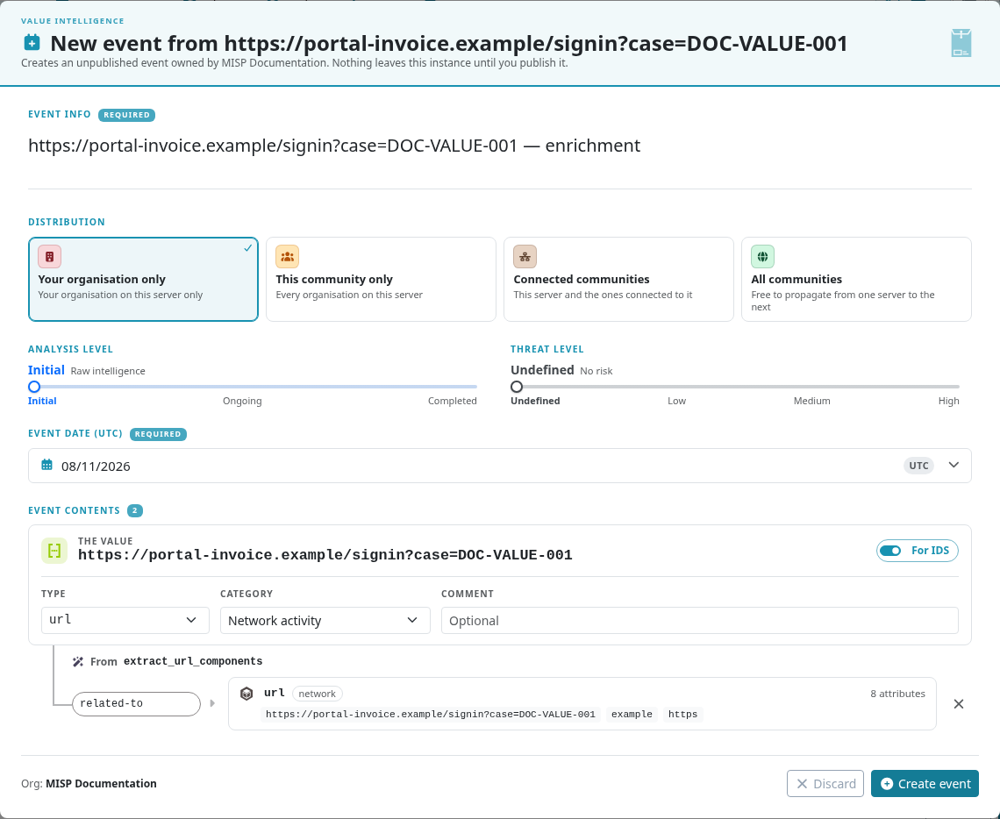

## Read the timeline and its gaps {#value-intelligence-timeline}

Open **Timeline** to compare activity across the value's accessible records.
The activity chart, source lanes and chronology describe different kinds of dated evidence.
Drag across the chart to select a period; the lanes and chronology follow that window.
Select a source in the key or a lane to focus the chronology, and use **Reset window** to return to the broader period.
Open a chronology entry to inspect its source record.

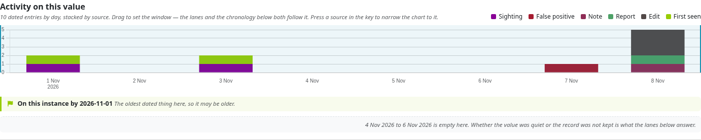

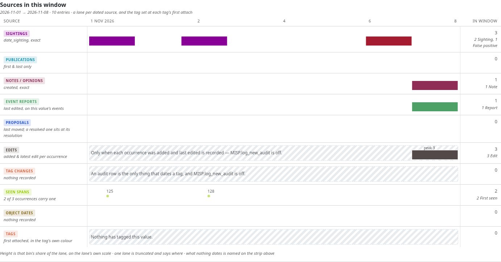

In the exercise, answer these questions:

1. **When was the URL reportedly observed?** A's span is 1 November, 09:00–09:10 UTC; B's is 3 November, 14:00–14:30 UTC. These are the attribute `first_seen`/`last_seen` claims.
2. **When were sightings recorded as having occurred?** The positive sightings fall inside those windows; the false-positive report is dated 7 November. A false-positive report contradicts a detection interpretation; it is not another positive sighting.
3. **When was the information entered here?** The exercise records, note and report were created on 8 November. Their creation/edit times are later than the observation windows. A header recency date does not replace an individual attribute's observation time.
4. **What remains undated or incomplete?** C's quoted comment has no observation span. The events were never published, so their publication lane is empty. The instance did not record a full audit trail.

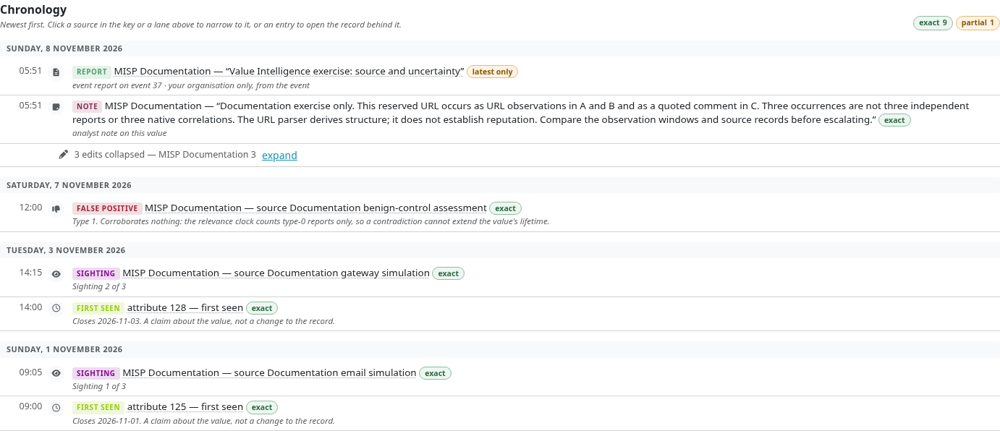

Do not read an empty period as proof of inactivity.
A source might not have collected the data, a field might be unset, or a historical change might not have been logged.
The timeline identifies precision and partial histories; some sources provide only first/latest states.
Repeated marks from one event or edit do not become independent observations.
On busy values, read truncation notices and distinguish whole-range totals from the selected window and displayed detail.

### History is the audit trail

**History** answers who changed stored records and what changed, where that audit data exists.
It does not replace **Timeline** or the observation fields.
On the fixture, **`MISP.log_new_audit`** is off, and History explicitly says **Not recorded**.
An administrator enabling it records changes going forward; it cannot reconstruct earlier edits.
Even without that audit log, occurrence creation/latest-edit times and dated sightings can still appear on Timeline.

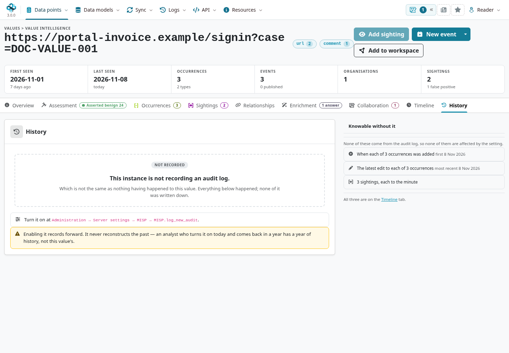

## Interpret the assessment in context {#value-intelligence-assessment}

Open **Assessment** and read the contributing signals, source organizations and explanation behind the label.
See [Analyst Profiles](../analyst-profiles/index.qmd) to choose, customize and test the rules behind that interpretation.
MISP resolves the effective **analyst profile** from the user, then organization, then instance default.
Weights, thresholds, exclusions and available evidence can therefore produce different readings for different analysts.
Record the profile and the evidence when passing an assessment to a colleague.

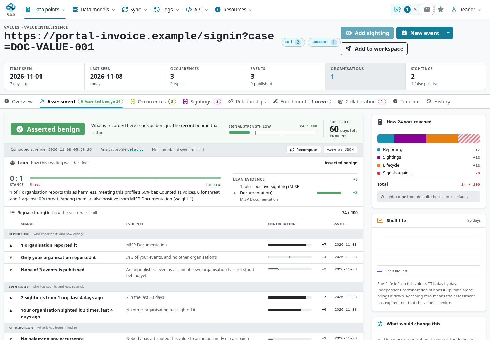

In this constructed case, the false-positive report contributes to an **Asserted benign** reading.
Investigate which occurrence and source it describes before generalizing to every use of the value.
One organization repeating its own report is not independent corroboration.
Similarly, a [warninglist](../warninglists/index.qmd) hit calls for context, while a miss means only that the checked lists did not match.

Signal strength, stance and **shelf life** are related assessment outputs, not substitutes for a [decaying-model score](../decaying-models/index.qmd).
An expired assessment needs review; expiry does not establish benignness.
A displayed label does not change an attribute's IDS flag, create a global false-positive exclusion or guarantee downstream export filtering.
See the [false-positive use case](../false-positives/index.qmd) for choosing the appropriate response.

## Leave a reusable conclusion {#value-intelligence-collaboration}

Use **Collaboration → Add note** to record reasoning that applies to the value across occurrences.
For this exercise, a useful note is:

> Fictional exercise: A and B contain URL observations; C quotes the text as a control. All three events come from one organization. Local URL parsing confirms structure only. Review the source reports, observation windows and B's false-positive assessment before making a detection decision.

Choose the note's distribution explicitly.
Use an opinion for an assessment with its supporting explanation, and an [Event Report](../event-reports/index.qmd) for the source narrative.
If a claim applies only to B's gateway observation, attach it to that attribute rather than to the value as a whole.
The Collaboration tab also brings together occurrence comments and reports from the value's events; those retain their own scope.

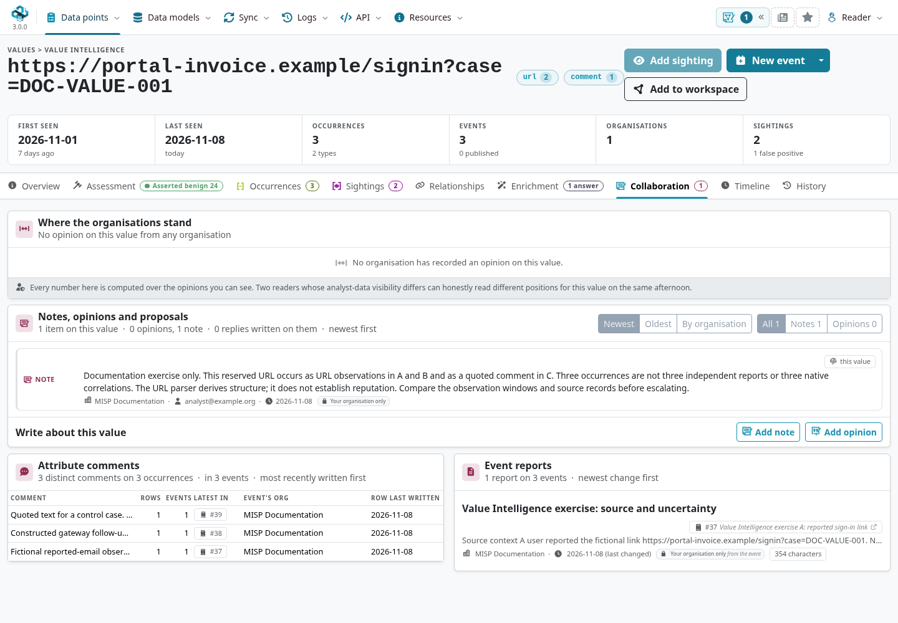

From the header's additional actions, **Add to collection** bookmarks the value in a [collection](../collections/index.qmd) for continued review.
Collection membership and analyst contributions have their own access rules; neither widens access to the underlying occurrences.
Use a workspace when you need an investigation canvas, and record an explicit relationship only when evidence supports that claim.

Finish the investigation with a decision and its limits: what was observed, which source supports it, which enrichment was performed and when, what contradicts the interpretation, and what would justify another review.
For this exercise, the defensible result is a documented comparison of the three contexts, not a claim that the reserved URL is a real threat.
