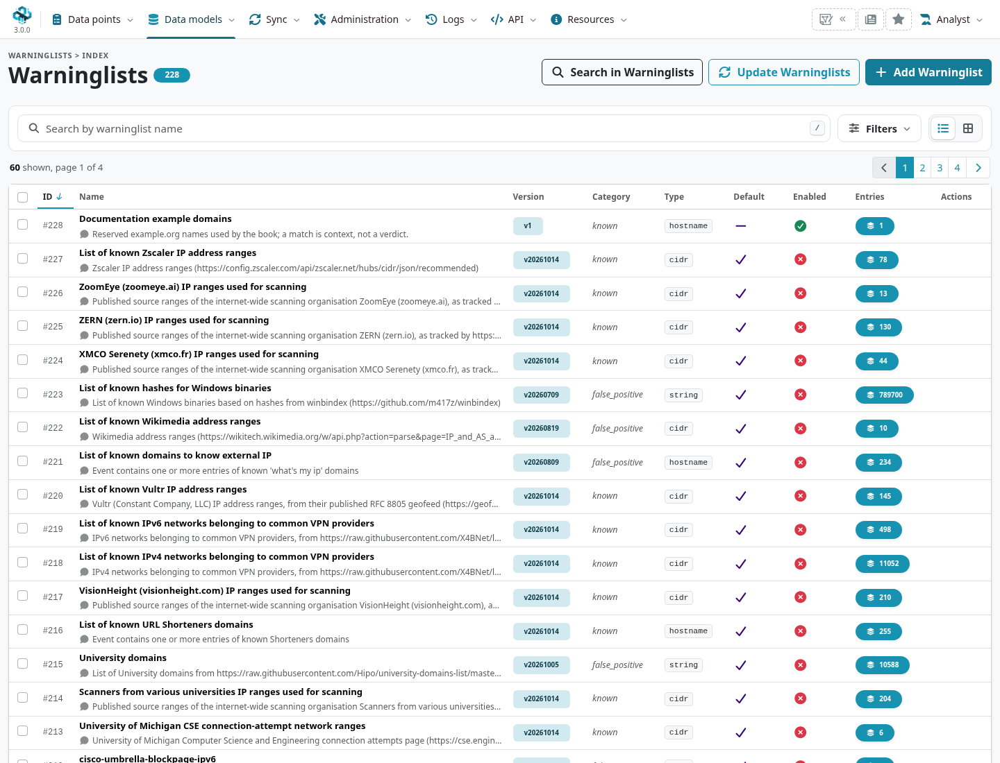
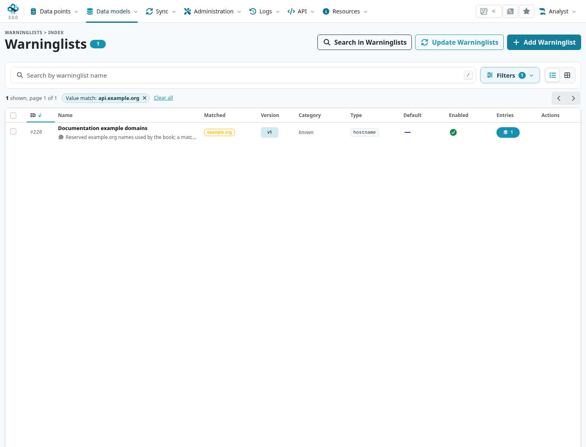
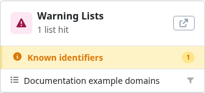
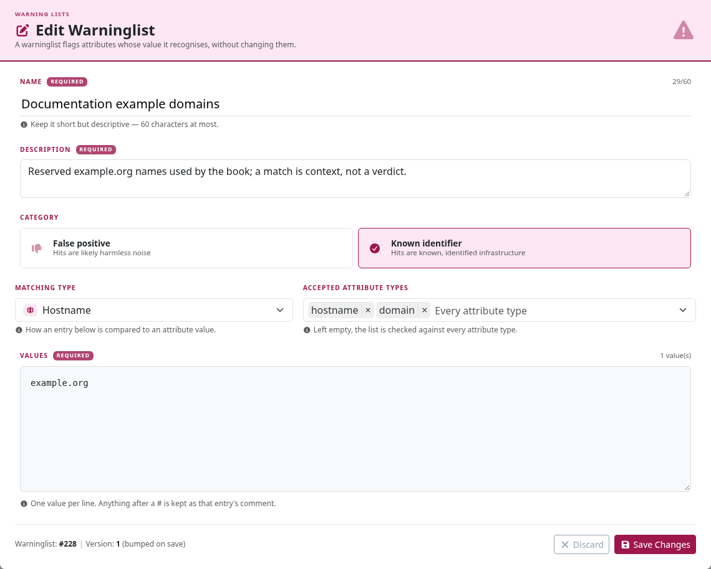

A warninglist adds context to a value that may need attention: reserved/private addresses,
public infrastructure, common domains, empty-file hashes or another known set. A hit is a
reason to review the observation and intended use, not proof that it is benign or malicious.

::: {.callout-note}
This chapter follows MISP **3.0.0**, `3.0_wip` commit `99ebee729`.
Lists come from [misp-warninglists](https://github.com/MISP/misp-warninglists) or local definitions.
The examples use a synthetic `known` list for reserved documentation domains, with IDS off.
:::

<!-- Matching checks, local-list fixture and captures: ../assets/data-model-screenshots.json -->

## Find a list or test a value {#warninglists-use}

Open **Data models → Filters & Lists → Warninglists** (`/warninglists/index`). Inspect category, matching type,
enabled state, default/local origin and entry count. Name search looks for list metadata;
**Search a value** looks for entries that actually match a value. They answer different questions.

Use the index's value-match filter to test a reserved domain/address. The pinned branch also
accepts a named `matchValue` filter, such as `/warninglists/index/matchValue:api.example.org`.
Multiple values use the supported `a||b` form. Only enabled lists participate in this lookup.
The old `/warninglists/checkValue` browser route redirects to the index in this branch; use its
value-match controls rather than expecting the historical standalone lookup form.

For API clients, `POST /warninglists/checkValue` accepts a JSON list of values and returns hits
by searched value. A successful result with no hit is not a validation that the value is safe;
the relevant list may be disabled, absent, stale or unsuitable for that input.

## Interpret the matching rules {#warninglists-matching}

::: {.table-responsive}

| List type | Match behaviour |
|---|---|
| `string`{.text-wrap .text-break} | Exact entry match. |
| `substring`{.text-wrap .text-break} | Entry occurs within the value. |
| `hostname`{.text-wrap .text-break} | Hostname/domain rules, including subdomains and supported extraction paths. |
| `cidr`{.text-wrap .text-break} | IP address belongs to an entry range. |
| `regex`{.text-wrap .text-break} | Entry regular expression matches the value. |

:::

Lists also declare matching attribute types; raw-value lookup does not supply the same type
context as an attribute check. Composite attributes and URL/hostname handling need the actual
matching path, not a hand-written substitute. Test exact, boundary/subdomain and non-matching
inputs when adding a local list.

A list's category describes its purpose. **`false_positive`** and **`known`** are not the same
assessment, and neither category establishes ground truth about an incident. Read the list's
source, description, version and matched entry before acting on a hit.

## Warnings, IDS flags and exports {#warninglists-export}

Attribute warning display normally checks IDS-enabled attributes, or all attributes when
`MISP.warning_for_all` is enabled. Changing warning display does not turn IDS on/off, block
publication or delete source data. It also does not mean every lookup/export uses identical
filters.

`enforceWarninglist` on supported `restSearch` exports can exclude matching attributes. Select
the format, enabled lists and source/detection scope explicitly and inspect the resulting
selection. A read-only investigation may need the matched context even when a detection export
should omit it. See [Automation & API](../automation/index.qmd#api-exports).

Do not treat a warninglist as a distribution policy, event blocklist, removed signature
allowedlist or replacement for reviewing detection content. A private address may be important
inside an investigation even when it is inappropriate for a public detection feed.

## Create and maintain local lists {#warninglists-management}

Use **Add Warninglist** for local entries. Choose a name, description, type, category, matching
attribute types and entries, then test it before enabling it for operational use. The form's
choices affect both what is compared and how values match.

Inspect the supported edit/delete and bulk enable/disable actions. Shipped defaults are
maintained through their repository/update mechanism; manage custom changes separately so
an upstream refresh does not overwrite a private policy.

For file-based lists, follow the upstream schema and directory structure under
`app/files/warninglists/lists/<name>/list.json`, increment versions for changes, deploy the
intended files and run **Update Warninglists** or `cake Admin updateWarningLists`.
The files, database entries and enabled/cache state are separate parts of the update.

Use [PyMISPWarningLists](https://github.com/MISP/PyMISPWarningLists) when a Python integration
needs these lists, checking its installed version and input/matching contract. An external
consumer's local list set is not automatically the same as the server's enabled configuration.
