MISP helps teams turn observations and reports into intelligence they can investigate, assess, share and use in security operations.
It combines a common data model, an analyst interface, controlled exchange and programmable interfaces.
This annex is a positive capability guide: start with an outcome, see how MISP supports it, and follow the links for the implementation.

The guide follows **MISP 3.0**, checked against [`3.0_wip` commit `99ebee729`](https://github.com/MISP/MISP/commit/99ebee729702c560528f9788953719bda68aa1c1).
The linked chapters provide detailed procedures, examples, source revisions and observed development-branch limitations.

<!-- Integration, license, authorization and CTI-CMM source references: ../assets/tip-capabilities-reference.json -->

{width=75%}

## Open-source availability {#tip-open-source}

The full MISP application is available in the open-source distribution: APIs, RBAC/ACL controls, sharing groups, workflows, dashboards, Value Intelligence and Analyst Profiles are available without a paid feature tier, per-user license or enterprise-edition unlock.
You can inspect, run, modify and extend the software under its license.
**misp-modules** and **misp-guard** are also open-source companion projects that can be deployed alongside MISP; the checked projects use AGPLv3 licenses.

Software availability and deployment configuration are separate decisions.
Administrators choose which features, triggers, modules and integrations to enable, and which roles may use them.
Some require companion services, dependencies or background workers.
External providers and consuming products retain their own account requirements, terms, quotas and possible charges; open-source integration code gives access to the connector, while access to a provider's service follows that provider's contract.

## Read the capability guide {#tip-guide}

Three kinds of capability work together:

- **Application features:** events, objects, search, correlation, analyst data, sharing controls and other tools exposed by the MISP application, according to permissions.
- **Configured services and automation:** feeds, enrichment, workflows, notifications and background processing, enabled and configured for a particular deployment.
- **Connected systems:** collectors, SIEM/EDR consumers, case-management systems and other integrations that exchange selected data through supported interfaces.

Each table gives a concrete starting point and links to the relevant chapters.
Choose the combination that fits your team's data, audience and operational purpose.

## Collect and structure intelligence {#tip-collect}

MISP can retain both machine-readable observations and the narrative needed to interpret them.
An event supplies investigation or reporting context; typed attributes describe values; objects model related properties; reports preserve prose and references.
Source comments and first/last-seen fields help explain where and when an observation was made.

::: {.table-responsive}

| Outcome | Put it into practice | Guide |
|---|---|---|
| Record an investigation or source report | Create an event, add typed attributes and retain the source and reasoning in a report. | [Using the System](../using-the-system/index.qmd), [Event Reports](../event-reports/index.qmd) |
| Model an entity and its relationships | Choose an object template, populate its properties and add explicit references to related entities. | [Data Model](../data-model/index.qmd), [MISP Objects](../misp-objects/index.qmd) |
| Make recurring collection consistent | Use an event template for the collection procedure and object templates for the resulting entities. | [Event Templates](../event-templates/index.qmd) |
| Bring in external intelligence | Select a feed, import module or API integration; choose its source format, import scope and review process. | [Feeds](../managing-feeds/index.qmd), [Modules](../modules/index.qmd), [Automation](../automation/index.qmd) |

:::

For example, an email investigation can preserve the source narrative in an event report and represent an extracted URL and its host in a URL object.
The resulting records let another analyst inspect the value together with the evidence that motivated its collection.

## Classify information and define its audience {#tip-classify}

MISP supports shared vocabularies and local working context.
Classification can express handling instructions, confidence, source information and the stage of an investigation.
Use TLP/PAP taxonomy labels to communicate handling, and distribution settings and sharing groups to enforce the intended audience.

::: {.table-responsive}

| Outcome | Put it into practice | Guide |
|---|---|---|
| Apply a consistent vocabulary | Enable appropriate taxonomies, attach their machine tags, and define a private vocabulary when the team needs one. | [Taxonomies](../taxonomy/index.qmd#taxonomy-authoring) |
| Keep a review label on the local instance | Use a **local tag attachment** on the intended event or attribute. Normal synchronization keeps that attachment instance-local. | [Tag scope and permissions](../taxonomy/index.qmd#taxonomy-use) |
| Apply repeatable classification rules | Configure a suitable workflow trigger and tagging action, or use an API script with explicit selection criteria. | [Workflows](../workflows/index.qmd), [API updates and tags](../automation/index.qmd#api-updates-and-tags) |
| Express confidence and source context | Combine source references, confidence taxonomies, reports and analyst assessments; keep the supporting evidence readable. | [Analyst Data](../analyst-data/index.qmd), [Taxonomies](../taxonomy/index.qmd) |
| Share selected parts with the right recipients | Set event, object and attribute distribution, inheritance and sharing groups. Check the recipient's view of the resulting record. | [Sharing & Synchronisation](../sharing/index.qmd) |
| Bring handling guidance into collection | Enable relevant notice lists and review their guidance when entering the affected kinds of data. | [Notice Lists](../noticelists/index.qmd) |

:::

A private event can contain additional restrictions on particular elements.
A child inherits the applicable parent restrictions; its setting cannot widen a restricted parent.
Before release, review both the markings that explain handling and the controls that determine access.

## Compose access controls for your community {#tip-access-controls}

MISP combines configurable role-based access control (RBAC), controller/action access-control lists (ACLs), organization and ownership checks, and record distribution.
This lets an operator define different analyst, publisher, organization-administrator, synchronization and integration roles using the same open-source software.
Effective access depends on both the permitted operation and the particular data involved.

::: {.table-responsive}

| Control layer | Capability and practical use | Guide |
|---|---|---|
| Roles and operation permissions | Combine a base data-access level with feature flags and resource limits. Separate creating, editing, publishing, tagging, synchronization and administration duties. | [Roles](../administration/index.qmd#roles) |
| Organization, ownership and record audience | Partition a multi-organization instance and restrict events, objects, attributes and other supported records through distribution and sharing groups. Child records retain the applicable parent restrictions. | [Sharing](../sharing/index.qmd), [Collections](../collections/index.qmd) |
| Authentication and API credentials | Use appropriately scoped service accounts and keys with expiry, source-IP restrictions and read-only options where suitable. Configure MFA and the intended interactive/API authentication paths. | [Authentication](../administration/index.qmd#admin-authentication), [API accounts](../automation/index.qmd#api-authentication) |
| External identity services | Integrate supported LDAP, OIDC, SAML/Shibboleth, client-certificate or trusted-header authentication and map the verified identity to a local organization and role. | [External authentication](../appendices/index.qmd#appendix-a-external-authentication) |
| Inspectable and extensible authorization | Inspect the installed controller/action ACL descriptors and effective role flags; review real-user ownership, distribution and resource checks as well. Source access permits audited local extensions. | [ACL descriptors](../appendices/index.qmd#appendix-acl-query), [Descriptor scope](../appendices/index.qmd#appendix-acl-limits) |
| Integration and module scope | Apply supported per-module organization restrictions and control the credentials and data sent to external services. Site-administrator privileges and companion-service access need their own deployment boundaries. | [Module configuration](../modules/index.qmd#modules-configuration), [Connector contracts](../connectors/index.qmd#connectors-contract) |

:::

A practical design might give analysts event-editing access, publishers the additional release permission, and an export service a read-only key attached to an account with the intended data visibility.
A query's tags and filters select results within that account's access; distribution and sharing groups determine the permitted audience.
Review effective flags and resource access whenever changing roles or identity-provider mappings.

### Enforce policy at a synchronization boundary with misp-guard {#tip-misp-guard}

[**misp-guard**](https://github.com/MISP/misp-guard) is an open-source mitmproxy addon that understands supported MISP synchronization traffic and inspects the messages passing through it.
An operator can deploy it as an additional policy-enforcement boundary between instances or compartments, alongside MISP's own authorization controls.
Its configurable rules cover compartment reachability, required taxonomies and allowed/blocked tags, distribution levels, sharing-group UUIDs, attribute types/categories and object types.
Matching prohibited content can cause the transfer to be rejected, with policy logging for review.

The guard is a separately deployed component on the actual traffic path.
Its default policy blocks outgoing HTTP requests beyond the supported synchronization routes unless the operator explicitly allows the destination/URL.
URL/domain allowlisting skips further normal message processing on those paths, so scope those exceptions deliberately.
Check the chosen version's endpoint and record coverage against the MISP 3.0 exchanges you need; sightings have a separate enablement setting, for example.
Provider calls made by modules and data delivered through other connectors need their own applicable access and egress controls.
See the [pinned guard configuration and rules](https://github.com/MISP/misp-guard/tree/79a3d4c89796f0a91201f5e9de82d89518b32a8a) and [Sharing](../sharing/index.qmd) when designing and testing the boundary.

## Discover, connect and enrich observations {#tip-investigate}

MISP can help analysts discover existing knowledge, identify related observations and follow promising leads.
Keep the distinction between a computed match, an asserted relationship and the evidence supporting an assessment visible throughout the investigation.

::: {.table-responsive}

| Outcome | Put it into practice | Guide |
|---|---|---|
| Find a useful selection of intelligence | Choose event, attribute, object, value or report search, then apply the matching mode and contextual filters appropriate to the question. | [Searching and Filtering Intelligence](../searching-filtering/index.qmd) |
| Find related observations | Inspect correlations for supported values, compare the linked events and review exclusions or noisy matches. | [Correlation](../correlation/index.qmd) |
| Investigate a value across its occurrences | Open Value Intelligence to review accessible context, assessments, enrichment and temporal information. | [Value Intelligence](../value-intelligence/index.qmd) |
| Follow an investigative lead | Select a meaningful observable, retrieve related records, compare their source and time context, and document the pivot. | [Pivoting](../pivoting/index.qmd) |
| Add context from a tool or provider | Select a configured enrichment module, inspect its input/output contract and review returned information before incorporating it. | [Modules](../modules/index.qmd) |
| Describe broader threat context | Attach relevant galaxy clusters and inspect the structured context behind those classifications. | [Galaxies](../galaxy/index.qmd) |

:::

A shared infrastructure value can connect several events while still requiring separate judgments about the organizations, activity and ownership involved.
The correlation and pivoting chapters show how to turn those connections into questions that can be checked.

## Assess, prioritize and maintain intelligence {#tip-assess}

MISP can preserve analyst judgment alongside observations and bring feedback into later decisions.
Source grades, confidence statements, relevance, warning context and detection eligibility each describe a different aspect of the intelligence.

::: {.table-responsive}

| Outcome | Put it into practice | Guide |
|---|---|---|
| Record and discuss an assessment | Add notes, opinions and relationships to supported targets, with evidence and distribution appropriate to the contribution. | [Analyst Data](../analyst-data/index.qmd) |
| Apply an understood assessment perspective | Choose or configure an analyst profile, inspect the evidence behind its results and record source grades in the appropriate scope. | [Analyst Profiles](../analyst-profiles/index.qmd) |
| Account for age and observation feedback | Select an applicable decaying model and inspect its inputs, formula and query-time score. | [Decaying Models](../decaying-models/index.qmd) |
| Recognize context that may need special treatment | Enable relevant warninglists, inspect matches and choose the IDS/export policy appropriate to the consumer. | [Warninglists](../warninglists/index.qmd), [False Positives](../false-positives/index.qmd) |
| Incorporate operational feedback | Record sightings, false-positive feedback or expiration information with the correct meaning and source. | [Sightings](../sightings/index.qmd) |
| Trace changes and contributions | Use event History and the available audit logs to review record changes and their authors, with the required permissions. | [Audit logs](../administration/index.qmd#admin-logs) |
| Keep the working record accurate | Review bulk edits, grouping, selective copies and deletion/restoration against the affected identities and context. | [Data Maintenance](../data-maintenance/index.qmd) |

:::

For example, a value can remain useful investigation context with its IDS flag off.
An analyst can document that decision, compare a profile's assessment, review warninglist matches and revisit it after new sightings.
A decaying score is a model result to interpret with the evidence; teams can choose models and thresholds for their own operational questions.

## Collaborate and exchange reviewed intelligence {#tip-collaborate}

MISP supports collaboration within an organization and across communities.
Contributions can retain their own attribution while publication and synchronization provide controlled ways to exchange eligible updates.

::: {.table-responsive}

| Outcome | Put it into practice | Guide |
|---|---|---|
| Separate preparation and release duties | Configure creation/modification and publication permissions, record the review in reports or analyst data, and have an authorized publisher release the result. | [User Management](../user-management/index.qmd), [Publishing](../using-the-system/index.qmd#publish-an-event) |
| Improve a partner's intelligence | Submit supported proposals for the owner's review, or add appropriately scoped analyst data. | [Proposals](../using-the-system/index.qmd#proposing-changes-to-another-organisations-event), [Analyst Data](../analyst-data/index.qmd) |
| Retain a separate contributing event | Create an extended event with its own ownership, context and publication lifecycle. | [Extended Events](../extended-events/index.qmd) |
| Exchange intelligence with a community | Configure peer accounts, distribution, sharing groups and synchronization rules, then verify eligible push/pull updates. | [Sharing & Synchronisation](../sharing/index.qmd) |
| Hand maintenance to a trusted coordinator | Request delegation and have the recipient review and accept the handover, including the attribution retained in the content. | [Delegation](../delegation/index.qmd) |
| Curate a research set | Create a collection of references and share it with an appropriate audience. Referenced records retain their own access controls. | [Collections](../collections/index.qmd) |

:::

For a peer-review process, define who prepares a record, how the reviewer records a decision, and who publishes it.
Those roles and records make the review understandable.
An automated gate can implement a tested condition on a supported blocking workflow path; a multi-stage approval process needs its own explicit design and state management.

## Automate processing and support security operations {#tip-operationalize}

MISP can supply selected intelligence to operational tools and accept observations or feedback from them.
Define the data selection, identity mapping and update behavior with the consumer so that intelligence stays useful as its source records change.

::: {.table-responsive}

| Outcome | Put it into practice | Guide |
|---|---|---|
| Supply a SIEM, EDR or investigation tool | Query/export selected records with an appropriately scoped account, supported types, audience, IDS and publication criteria. | [Automation & API](../automation/index.qmd), [PyMISP](../pymisp/index.qmd), [Connectors](../connectors/index.qmd) |
| Exchange intelligence in supported formats | Choose native MISP JSON or a supported export/converter, and check the format/version and field mapping with the recipient. | [API exports](../automation/index.qmd#api-exports), [Connectors](../connectors/index.qmd) |
| Apply repeatable processing or notification rules | Have a site administrator configure the relevant workflow trigger, logic and action modules, including its execution and recovery behavior. | [Workflows & Blueprints](../workflows/index.qmd) |
| Respond to changes through an integration | Use API polling or configured notifications with checkpoints, reconciliation and a defined consumer. | [Incremental polling](../automation/index.qmd#api-incremental-polling), [Notifications](../misp-zmq/index.qmd) |
| Coordinate with incident or case handling | Connect a maintained case/ticketing integration and preserve MISP UUIDs and context when exchanging investigation updates or feedback. | [External Connectors](../connectors/index.qmd) |
| Build useful analyst views | Configure integrated dashboard widgets and their individual filters for a review queue, recent assessments or another recurring question. | [Dashboards](../dashboards/index.qmd) |
| Compare source contributions and outcomes | Define the comparison criteria, select the relevant records and feedback, and combine API/dashboard information with recorded source assessments. | [Dashboards](../dashboards/index.qmd), [Source grades](../analyst-profiles/index.qmd#profiles-source-grades), [Automation](../automation/index.qmd) |

:::

Record the dataset, time window and account visibility behind a metric.
When evaluating downstream use, arrange for consumers to return the observations or feedback your comparison needs.
This makes a count of stored records, a source grade and a measure of operational usefulness separately interpretable.

## Reuse 300+ modules across SOC, SOAR and CTI pipelines {#tip-modules-integrations}

[**misp-modules**](https://github.com/MISP/misp-modules) provides a growing library of **300+ open-source modules** across expansion, import, export and action families.
The checked [3.1.4 source](https://github.com/MISP/misp-modules/tree/64fc7bc8764e6d0a1ff5c833f64555d8c2f3055a) contains 313 module source files across those families; the [live catalogue](https://misp-project.org/modules/) is the discovery point, and your service's `GET /modules` response identifies what its installed dependencies actually make available.
This supports SOC triage and response as well as malware research, vulnerability/exposure management, fraud and brand investigations, and production of intelligence for other teams.

The same service can be used from MISP's UI, a configured workflow, a SOAR runbook, an ETL pipeline or another CTI tool.
Its independent HTTP API exposes discovery and `POST /query`; the standalone web interface and **misp-modules-cli** provide additional ways to use the service.
A pipeline can therefore reuse enrichment or conversion logic while keeping its existing scheduler, case system and data processing stages.
See [standalone use](../modules/index.qmd#modules-standalone), the [CLI](../modules/index.qmd#modules-cli) and [module API](../modules/index.qmd#modules-api).

### Choose an integration by its contract

::: {.table-responsive}

| Operational use | Examples in the checked module source | Result and integration boundary |
|---|---|---|
| SOC investigation and context | `urlscan`, `virustotal`, `shodan` | Retrieve provider context for relevant observables, then review and preserve its provenance. Provider access and the particular module's input/output contract apply. |
| Vulnerability and exposure prioritization | `vulnerability_lookup` | Bring advisories and related context such as EPSS and known-exploited assertions into the investigation; combine this with asset criticality supplied by the asset/vulnerability-management process. |
| Malware analysis and sandbox pipelines | `cuckooimport`, `joe_import` | Convert supported sandbox reports into structured MISP content. The sandbox produces the analysis; the import module parses the supported report. |
| SIEM and data engineering | `elastic_ecs_export`, `splunk_export` | Produce ECS Bulk NDJSON or a Splunk CSV lookup from supplied MISP events. The existing pipeline performs destination ingestion and lifecycle reconciliation. |
| Detection engineering | `sigma_export`, `yara_export` | Export supported rule content and use the selected module's documented conversion options. Validate the resulting rules in the target tool and preserve their source identity. |
| Controlled response through workflows or SOAR | `qradar_reference_set_publish`, `sentinelone_ioc_publish`, `crowdstrike_ioc_publish` | Write supported indicators to explicitly configured destination scopes. Check acknowledgements, available dry runs and each module's creation/renewal/withdrawal behavior. |
| Existing Microsoft security pipelines | `export_sentinel` | Invoke an existing MISP2Sentinel or MISP2Defender installation. This action depends on that separately configured integration. |
| Context from another CTI platform | `opencti` | Perform read-only observable lookups and return context, provenance and supported markings. Review the result and set the intended MISP distribution; the source platform's access rules require an explicit mapping. |

:::

These are concrete examples from the [pinned module tree](https://github.com/MISP/misp-modules/tree/64fc7bc8764e6d0a1ff5c833f64555d8c2f3055a/misp_modules/modules), rather than a fixed list of supported commercial products.
A format exporter, a lookup and an action that writes to another system each have a different contract.
The OpenCTI example is a lookup, while the ECS/Splunk examples produce data for a downstream importer; complete platform synchronization or SIEM deployment needs the corresponding integration process.

### Connect the intelligence and response loops

For a SOAR or case-management workflow, select the incoming observables, query MISP with a scoped account, reuse the required module lookups, and attach the resulting event/attribute UUIDs and provenance to the case.
Have the consuming tool return the appropriate sighting, false-positive feedback, proposal or analyst note after review.
For an action module, define which decision authorizes the write and how the workflow handles a partial failure.
Publication, renewal, expiry and deletion support vary between destination modules, so record that lifecycle contract with the runbook.

Keep the existing pipeline's responsibilities visible: collectors obtain observations, modules enrich or convert supported data, MISP retains and shares intelligence, and consumers execute the agreed operational action.
The [connector data contract](../connectors/index.qmd#connectors-contract) covers identity, selection, delivery, reconciliation and feedback.
Teams can add a new Python module through the public [contributor guide](../modules/index.qmd#modules-development), including the [AI-assisted development training](../modules/index.qmd#modules-ai-development), and deploy it through the same service interface.

## Combine the capabilities in a practical workflow {#tip-example}

Consider a team investigating the fictional URL **`https://portal.example/login`{.text-wrap .text-break}**.
This is a workflow design to adapt using the linked procedures; it does not require visiting that example address.

1. **Collect with context.** Create an organization-only event, preserve the source narrative in a report, and add a URL object with its hostname and observed times. Keep the exercise's IDS flags off.
2. **Classify and investigate.** Apply the appropriate source/confidence and handling information. Search the hostname and URL, inspect accessible correlations and compare other observations with the source report.
3. **Enrich and assess.** Use a configured module where it adds relevant context. Review the returned information, record the analyst's reasoning, and inspect the effective profile and warning context before deciding how to use the value.
4. **Collaborate and release.** Ask a colleague to record a review, choose the intended distribution/sharing group and have the authorized publisher release the reviewed intelligence. Verify what the intended recipient can access.
5. **Use and learn.** Deliver the selected records through an API query or connector, preserving UUIDs and update state. Bring operational sightings or false-positive feedback back into the assessment and maintain the record as the evidence changes.

Two additional patterns use the same building blocks:

- **An analyst review queue:** apply agreed review labels through a tested workflow or API process, configure a dashboard widget to select that queue, and record the review outcome. A taxonomy defines the label's meaning; the configured automation implements the rule.
- **A domain watch:** curate the relevant values and context in a collection, have a collector supply fresh DNS or other observations, and use a scheduled API selection or suitable workflow to identify matches and notify a configured channel. The collector supplies new evidence; MISP stores, connects and processes the intelligence.

## Support a CTI-CMM 1.3 improvement program {#tip-cti-cmm}

[**CTI-CMM 1.3**](https://github.com/cti-cmm/framework/blob/f42e71e962b920063ca61f83be6f905a753e956c/CTI-CMM%20book%20Version%201.3.pdf) describes how a CTI program supports stakeholder decisions across **11 domains**.
MISP supplies capabilities for collecting evidence, producing intelligence, exchanging it and incorporating feedback into that work.
The following mapping is an implementation aid written for this guide: assess the organization's actual practices and stakeholder outcomes against the framework.
A deployed feature or a module count is evidence of available tooling; the maturity assessment also needs the people, agreed process, repeated delivery and measured effect.

References below use the PDF's numbered pages and section identifiers, checked against the linked revision.
The capability and evidence descriptions are this guide's own mapping.

::: {.table-responsive}

| CTI-CMM domain and reference | How MISP can support the work | Evidence to retain with the stakeholder |
|---|---|---|
| **ASSET — Asset, Change, and Configuration Management** (§6.1, pp. 24–25) | Combine asset identifiers and criticality from an inventory integration with [vulnerability/exposure enrichment](#tip-modules-integrations), reports and correlation to relevant threats. | Trace an asset-related intelligence requirement to the observations, assessment and asset owner's prioritization or remediation decision. |
| **THREAT — Threat and Vulnerability Management** (§6.2, pp. 26–28) | Use vulnerability modules, [galaxy/TTP context](../galaxy/index.qmd), actor/campaign reporting, source assessments and detection exports to deliver relevant threat and vulnerability intelligence. | Preserve the basis for a priority, the delivered detection or mitigation recommendation and feedback from the defensive team. |
| **RISK — Risk Management** (§6.3, pp. 29–30) | Prepare source-backed threat assessments using reports, collections, confidence statements and [analyst data](../analyst-data/index.qmd), and deliver them to the risk process through an integration or briefing. | Link the assessment to a business scenario, risk-register entry and a recorded decision by the accountable risk owner. |
| **ACCESS — Identity and Access Management** (§6.4, pp. 31–32) | Collect and contextualize identity-related threat observations, phishing/credential-theft activity and relevant vulnerabilities; route reviewed intelligence to [IAM/SOAR responders](#tip-modules-integrations). | Record the IAM team's assessment and action, delivery/remediation timing and feedback used to improve the alert route or identity protections. |
| **SITUATION — Situational Awareness** (§6.5, pp. 33–34) | Combine search, Value Intelligence, timelines, [dashboards](../dashboards/index.qmd) and curated reports/collections for a stakeholder's current and emerging threat questions. | Retain the requirement, scoped data selection, recurring product and the recipient's feedback or decision. |
| **RESPONSE — Event and Incident Response, Continuity of Operations** (§6.6, pp. 35–37) | Enrich incident observables, follow correlations, deliver selected intelligence to [case/SOAR tools](../connectors/index.qmd) and return response observations through sightings or analyst data. | Link MISP UUIDs to incident cases, investigative decisions, response outcomes and the improvements made after feedback. |
| **THIRD-PARTIES — Third-Party Risk Management** (§6.7, pp. 38–39) | Organize supplier-related identifiers and [reporting](../event-reports/index.qmd), connect relevant exposure/threat intelligence and exchange reviewed context with the third-party risk or supply-chain team. | Connect the intelligence to an identified supplier, an owned vendor review or incident decision, and subsequent stakeholder feedback. |
| **FRAUD — Fraud and Abuse Management** (§6.8, pp. 40–42) | Use phishing/brand/domain observations, enrichment, correlation, collections and an appropriate [analyst profile](../analyst-profiles/index.qmd) to support a fraud team's investigations. | Record the campaign or case, the fraud/brand team's disposition and the operational effect of the shared intelligence. |
| **WORKFORCE — Workforce Management** (§6.9, pp. 43–45) | [Curate](../collections/index.qmd) relevant adversary activity and reporting for role-specific awareness, training or workforce-risk discussions; preserve the rationale and audience. | Show how a workforce stakeholder used CTI to tailor training, awareness or another human-risk decision and evaluated the result. |
| **ARCHITECTURE — Cybersecurity Architecture** (§6.10, pp. 46–47) | Supply actor/TTP, vulnerability and incident context through [reports/collections](../collections/index.qmd), and link recommendations to the architecture team's threat models and design reviews. | Retain the threat-informed recommendation, the control/design decision it influenced and the result of later validation. |
| **PROGRAM — Cybersecurity Program Management** (§6.11, pp. 48–49) | Organize requirements and intelligence products in reports/collections, retain source and review history, and combine [dashboard/API information](../automation/index.qmd) with stakeholder feedback. | Link cybersecurity program priorities and investments to delivered intelligence, governance decisions and a recurring review of measurable stakeholder value. |

:::

For **ACCESS**, the framework's focus is intelligence support to the organization's identity and access mission.
MISP's own authentication, RBAC and sharing controls protect the platform enabling that support; document the identity-threat intelligence delivered to IAM stakeholders as well.
Likewise, the RISK and PROGRAM mappings connect MISP's evidence and products to decisions owned by the organization's risk and program processes.

### Use the framework's maturity levels as a process guide {#tip-cti-cmm-evidence}

CTI-CMM defines **CTI0 (Pre-Foundational)**, **CTI1 (Foundational)**, **CTI2 (Advanced)** and **CTI3 (Leading)** (§4.3, pp. 16–17).
The same open-source MISP capabilities remain available at every stage.
The progression concerns how the organization performs and improves the practices: from initial delivery, through documented and repeatable operation, to sustained stakeholder outcomes and continuous improvement.

For example, to support the identity-alert integration practice **ACCESS-1.c** (p. 31):

1. Agree with the IAM team which identity-threat intelligence warrants action, its permitted audience and the expected response.
2. Use an appropriate source/collector, MISP records and enrichment, then deliver a reviewed, scoped alert through an API integration, workflow or SOAR runbook.
3. Retain the source and MISP UUIDs, classification, assessment, delivery timestamps and the IAM/case reference. The IAM/SOAR system performs its authorized account-remediation actions.
4. Collect disposition and timing feedback, record failures and improve the repeatable route with its owner.
5. Assess that evidence against the framework's actual practice, including the required consistency and stakeholder engagement.

A dashboard count can describe throughput.
To evaluate value, define the outcome and denominator with its owner: for example, the proportion of eligible IAM alerts acknowledged within the agreed interval, together with the team's assessment of their usefulness.
Use the framework's improvement cycle (§5, pp. 18–23) and metrics discussion (Appendix C, pp. 55–60) to choose and review evidence appropriate to the domain.
Record the metric's scope, visibility, time window and external feedback sources alongside the query or report producing it.

## Choose a starting outcome {#tip-start}

Start with one result the team can inspect: a documented investigation, a useful correlation lead, a reviewed event received by a partner, or a consumer supplied with a reproducible selection.
Choose the required application features and configure the services or integrations involved.
For every process, identify the contributing accounts, the data and audience in scope, the review decision and how updates or feedback are handled.

The linked chapters describe the permissions and deployment requirements for each capability.
For example, enrichment uses the modules/providers configured on the instance, workflows require enabled triggers/modules and functioning background processing, and an external consumer needs a maintained integration and its own credentials.
The integrated dashboard and the separate misp-dashboard application have their own deployment and data scopes, described in [Dashboards](../dashboards/index.qmd) and the [integration FAQ](../faq/index.qmd#faq-integrations).

### Sources and contribution

Integration examples were checked against [misp-modules 3.1.4](https://github.com/MISP/misp-modules/tree/64fc7bc8764e6d0a1ff5c833f64555d8c2f3055a), [misp-guard `79a3d4c8`](https://github.com/MISP/misp-guard/tree/79a3d4c89796f0a91201f5e9de82d89518b32a8a) and their licenses/implementation.
The framework mapping cites the CTI-CMM authors’ [version 1.3 PDF](https://github.com/cti-cmm/framework/blob/f42e71e962b920063ca61f83be6f905a753e956c/CTI-CMM%20book%20Version%201.3.pdf).

The capability questions in [PR #289](https://github.com/MISP/misp-book/pull/289) by [Nicolas-Pellletier](https://github.com/Nicolas-Pellletier), originating in [MISP issue #9005](https://github.com/MISP/MISP/issues/9005), inspired this annex.
This guide connects those practical questions to the MISP 3.0 documentation and current assessment, collaboration and integration features.
To add a capability, describe a concrete outcome, its implementation and prerequisites, and link a maintained procedure or example; see [How to Contribute](../contributing/index.qmd).
