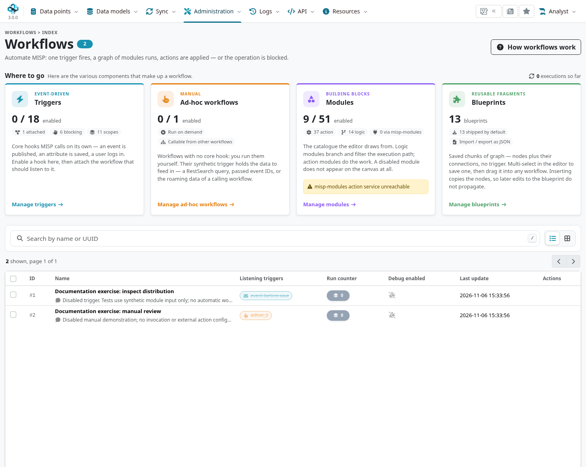
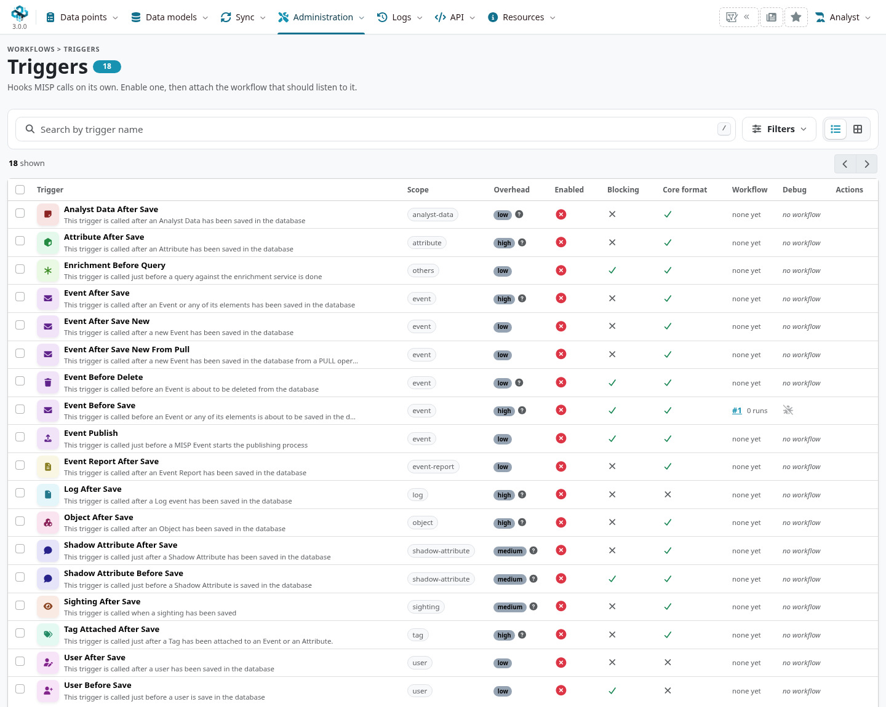
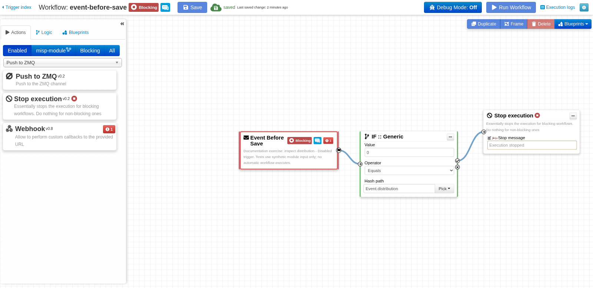
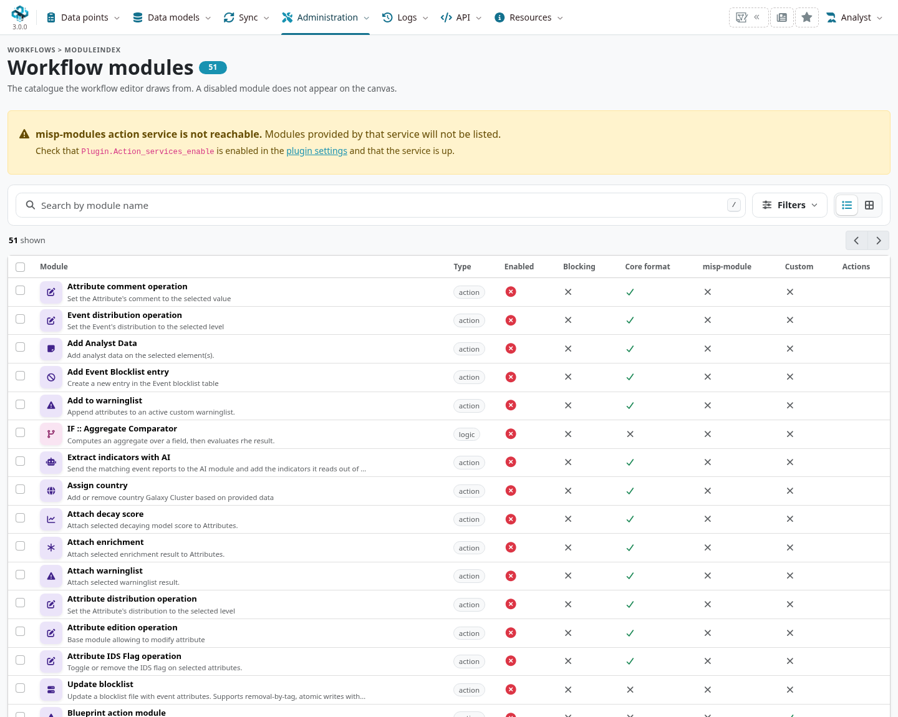
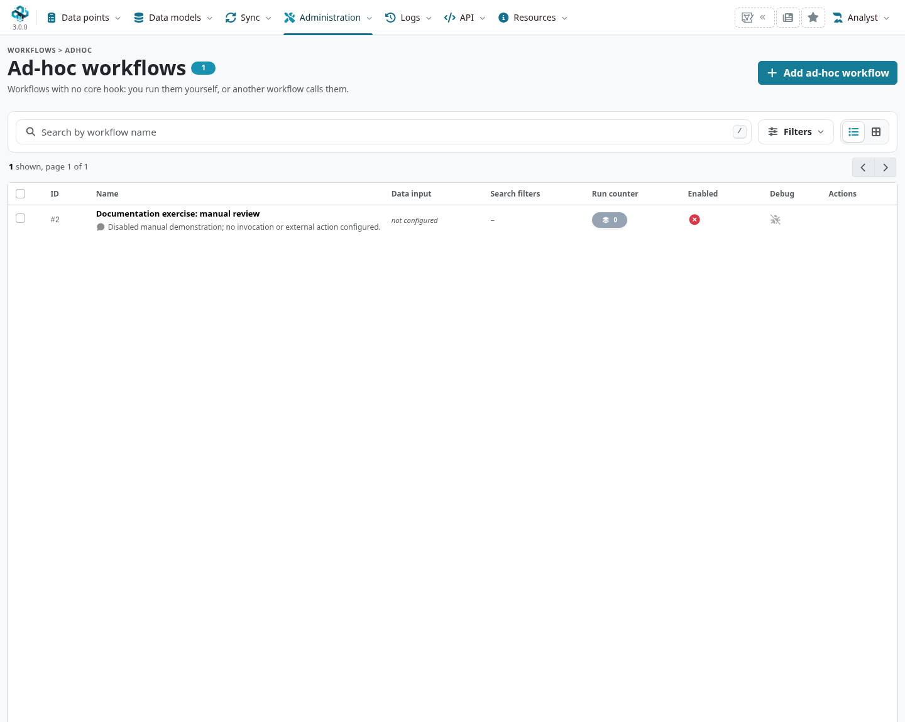
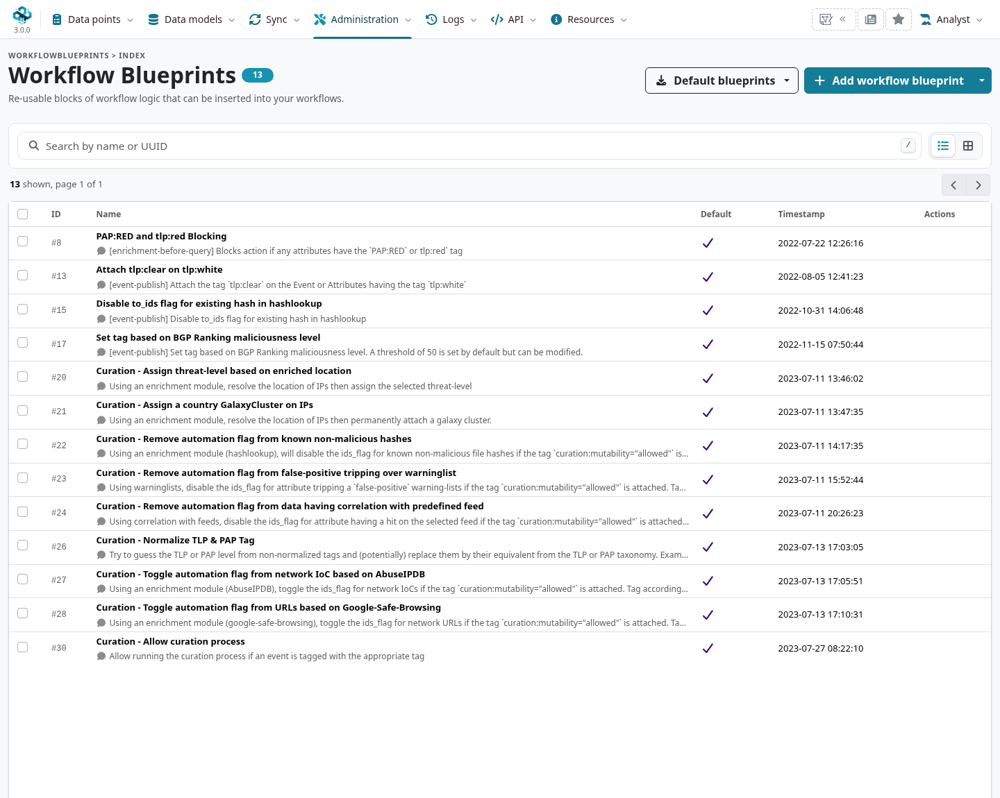

Workflows connect a MISP trigger to a graph of logic and action nodes. Use them for a specific,
testable policy or processing task: select the relevant data, decide what should happen and
record how to recover if an action fails. A workflow can modify intelligence, contact a service
or prevent a core operation; its execution context matters as much as its diagram.

::: {.callout-note}
This chapter follows MISP **3.0.0**, `3.0_wip` commit `99ebee729`, in Overmind.
Workflow and blueprint administration is **site-admin only**. The editor still uses its own
canvas interface in this branch. Screenshots show a local training graph with its automatic
trigger disabled; select a figure to enlarge it.
:::

<!-- Sources, disabled-trigger fixture and capture hashes: ../assets/administration-screenshots.json -->

## Start from the workflow hub {#workflow-hub}

Open **Administration → Workflows**. The 3.0 hub separates four destinations:

::: {.table-responsive}

| Destination | What to manage |
|---|---|
| **Triggers** | Core hooks, enabled state, scope, blocking behaviour and attached workflow. |
| **Ad-hoc workflows** | Manually invoked workflows and their input configuration. |
| **Modules** | The logic/action catalogue and individual module enablement. |
| **Blueprints** | Reusable graph fragments, imported/exported as JSON. |

:::

The prerequisites are `MISP.background_jobs`, `Plugin.Workflow_enable` and working Redis.
Configure the feature under **Server Settings & Maintenance → Integrations → Workflows**;
verify the [background workers](../administration/index.qmd#admin-background-jobs) too.
An available UI is not proof that a non-blocking job will be processed.

Each core trigger has its own `Plugin.Workflow_triggers_<trigger-id>` switch and must have a
saved graph listening to it. Creating/saving a graph does not by itself enable that trigger.
Check the trigger list, not only the editor's **saved** indicator.

## Understand data and execution paths {#workflow-execution}

A graph contains exactly one trigger and must be acyclic. Its nodes include:

- **Trigger**: an operation in MISP, or a synthetic entry point for an ad-hoc workflow.
- **Logic**: IF/ELSE decisions, filters and concurrent branches. An IF selects an output; a
  filter narrows the data passed downstream. These are different operations.
- **Action**: tag, enrich, add research data, send a request, publish or stop execution,
  according to the module and its configuration.

Nodes receive **roaming data**, which the trigger normalizes for its scope. Inspect the data
shape before writing a hash path. A path such as `Event.distribution` is not a universal path
for every trigger; an empty lookup can be a schema mismatch rather than a negative verdict.

### Blocking and non-blocking {#workflow-blocking}

A **blocking** path executes synchronously as part of the triggering operation. A blocking
failure or **Stop execution** can prevent that operation. In the pinned branch, blocking
triggers include event before-save, event before-delete, event publish, proposal before-save,
user before-save and enrichment before-query.

A **non-blocking** trigger normally queues background execution. Its outcome cannot undo the
core operation that already took place. The graph also supports concurrent paths; evaluate
which work remains in the blocking path rather than treating every connected action as a
transaction. Remote effects already performed are not rolled back automatically.

A Stop execution node on a non-blocking path cannot retroactively block the original save or
publication. The editor warns about incompatible paths. Review node failures, disabled modules
and timeouts too; a policy should define whether the desired result is to stop or continue.

Before-save hooks can run repeatedly during attribute imports and synchronization. Keep the
blocking path small and predictable. Avoid an unbounded provider request in a frequently used
save hook; it can delay or prevent many otherwise unrelated writes.

## Build and inspect a graph {#workflow-editor}

From **Triggers**, open the editor for the intended hook. From **Ad-hoc workflows**, add/open a
manual workflow. Choose enabled logic/action nodes, drag them onto the canvas and connect the
named outputs to inputs. Configure each node, save, then inspect validation warnings.

### An isolated first exercise {#workflow-exercise}

Start with a condition that needs no external service:

1. Keep **Event Before Save** disabled in the trigger list.
2. Add **IF :: Generic**, with hash path `Event.distribution`, operator **Equals**, value `0`.
3. Connect its **then** output to **Stop execution**. Leave the stop message empty to use its
   built-in default. The example deliberately matches private data; it is an exercise, not a
   recommended rule to deploy.
4. Test the condition module with synthetic `{"Event":{"distribution":"0"}}` and then `"3"`.
   Confirm both branches and inspect a missing-field input.
5. Save and review the graph. Confirm the automatic trigger is still disabled.

**Test module** executes that module; it is **not a sandbox or a universal dry-run**. Use
side-effect-free logic for an initial test. A webhook, mail, publish or data-changing action can
still have real effects when tested. **Run Workflow** similarly executes the selected workflow
with its input and prerequisites; it is not just a diagram preview.

A disabled trigger can return a successful response with **Module disabled**, without running
the graph. Check the outcome, counters and logs rather than treating any `success: true` as
proof that the policy was exercised. An end-to-end blocking test belongs on an isolated instance
with synthetic data and a recovery path.

### Enable only the required modules {#workflow-modules}

Open **Modules** to inspect the catalogue, dependencies and enabled state. Disabled modules do
not appear in the normal enabled-node palette. The core has a default module set, but an
existing deployment's Redis/module state can differ; verify it instead of assuming all nodes
are available after enabling the feature.

Core nodes and [misp-modules](../modules/index.qmd) service-provided actions have different
prerequisites. Some templated parameters also depend on the service's Jinja renderer, including
parameters on otherwise core nodes. Verify the rendered value as well as the module response.
A missing service or disabled module is not equivalent to a deliberate policy decision.

Review outbound destinations, credentials, data scope, timeout and retry/idempotency before
using external actions. Include deletion, access changes and repeated delivery in the design;
see [External Connectors](../connectors/index.qmd#connectors-contract).

## Run ad-hoc workflows deliberately {#workflow-adhoc}

Ad-hoc workflows use a generated trigger and run on demand, from a supported event action,
API request, scheduled task or another workflow. Their input modes include passed event IDs,
a REST search or roaming data from a calling workflow. Check the selected mode and parameters
before execution; a broad search can select far more data than an interactive example.

Creating a workflow from the 3.0 add dialog without a graph creates an ad-hoc entry. Give it a
clear name, choose its data-input scope and configure/test its graph before enabling or invoking
it. A module can call another ad-hoc workflow; inspect the whole call chain for repeated work,
external effects and privilege assumptions.

## Reuse blueprints {#workflow-blueprints}

A blueprint stores **nodes and their connections, without the live trigger binding**. Import
JSON or save a selected graph fragment in the editor, then insert a copy into another graph.
Editing the blueprint later does not update every graph into which it was copied.

**Default blueprints** loads/updates definitions from the local
`app/files/misp-workflow-blueprints` submodule. Updating that checkout and importing its newer
definitions into the database are separate steps. Definitions are matched by UUID/timestamp;
custom edits are not a promise that a later forced default update preserves them.

Inspect every imported node, parameter, URL and dependency. A shared blueprint is executable
configuration, not an approved automation simply because it came from a familiar source.
Review and save the receiving graph, then check its enablement and execution context separately.

## Monitor, debug and recover {#workflow-debugging}

Workflow run counts, execution/audit messages and `app/tmp/logs/workflow-execution.log` help
trace outcomes. Enable a workflow's **Debug Mode** only for the intended investigation. It can
record roaming data and per-node details; `Plugin.Workflow_debug_url` can also send execution
snapshots to a receiver. That receiver becomes a data destination, not just a local log viewer.

For an unexpected outcome:

1. Confirm feature, trigger and module enablement and the graph actually attached to the hook.
2. Inspect the trigger's input/normalization and condition output.
3. Distinguish synchronous failure, a queued job, a disabled no-op and a completed action.
4. Check worker and service logs, timeouts and downstream acknowledgement.
5. Disable the affected trigger or pause callers if needed, correct the graph and retest both
   intended and rejected cases before resuming it.

A retry can repeat an external write. Do not assume a graph is transactional or that disabling
its trigger cancels a previously queued/running job. Keep a known-good graph export and an
administrator recovery procedure for policies that can block saves or logins.

## Permissions, API and CLI {#workflow-api}

Workflows run with a **privileged system user for the host organisation**, or a valid
site-administrator fallback. They do not inherit only the initiating analyst's data visibility.
The initiator can be retained for logging/notifications, but that is not an execution ACL.
Review event selection and information sent externally with this context in mind.

The REST controllers are `/workflows/` and `/workflowBlueprints/`. Use the documented
index/view/add/edit/import/export operations with a site-admin account and explicit error
handling. For example, POST `{"format":"mermaid"}` to `/workflows/view/{id}` exports the graph;
the JSON response carries the diagram in `message`. Do not assume a generic query-string
parameter is accepted by every controller action.

`POST /workflows/checkGraph` accepts the serialized graph in `graph`; it checks cycles,
connection constraints and path warnings. It does not prove that providers are reachable or
that a policy has the intended effect. `/workflows/moduleStatelessExecution/{module-id}`
executes a module with `input_data` and `module_indexed_param`; apply the same side-effect review
as the UI's test action.

The `cake Workflow` shell supplies background execution entry points such as
`executeWorkflowForTrigger`, `executeAdHocWorkflow` and `walkGraph`. Normally the job system
invokes them. Use the deployed checkout's help and input contract rather than copying internal
worker arguments into a recurring task.
